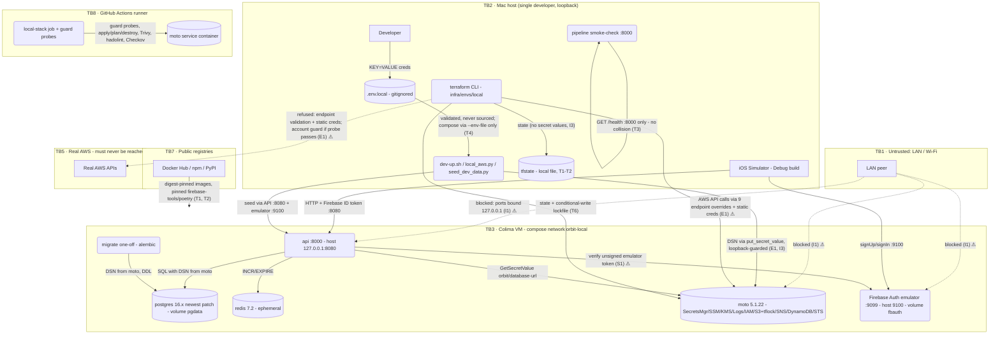

# Plan: A1 — Local environment (docker-compose + Terraform on moto + Simulator)

## Summary

A1 makes the whole Orbit backend start locally with one command, and in a way that looks like AWS.
`scripts/dev-up.sh` does the following:
1. Starts a docker-compose stack (Postgres 16 on the newest 16.x patch, Redis, an in-repo
   Firebase Auth emulator image, **moto server** as the local AWS emulator, and the API built
   from a new multi-stage Dockerfile).
2. Runs `terraform apply` on a new `infra/envs/local/` root, which reuses the existing shared
   modules against moto.
3. Writes the local database DSN into moto's Secrets Manager. The API then reads it **through its
   existing secrets facade, with zero code changes**: boto3 honors `AWS_ENDPOINT_URL` natively.
4. Runs migrations as a one-off container of the same image.
5. Seeds a dev user and demo data through the real API, then health-checks.

`scripts/dev-down.sh` reverses all of this. It keeps volumes by default; `--clean` wipes them.
The iOS Debug build points at the containerized stack through a committed xcconfig. The
CLAUDE.md done-flow is proven **in-run** by the existing `SmokeUITests`, running on the Simulator
against the containers.

**Why this approach.** The authoritative brief already fixed the big calls:
- moto, not LocalStack (licence and cost);
- plain uvicorn now, Lambda runner in A2;
- shifted host ports;
- staged Terraform state;
- one new CI job;
- an idempotent `dev-up`.

This plan's own choices follow one principle: **local differs from live only in configuration**.
- There is no `if local:` in `src/orbit/`. Proven by a test.
- No module is forked. `modules/data` is split; `modules/secrets` gains a variable.
- The app takes the same secret-fetch path it will take in AWS.

The alternative of compose with `DATABASE_URL` injected everywhere would have been simpler. It
would also have taught nothing about the deploy path and left the secrets facade unexercised
until E1.

Terraform-against-moto is the run's primary technical risk, so it is task T1. The spike in
requirements.md already proved that the `secrets` resource mix works. This plan adds one
**newly verified risk** to it, covered in §Infrastructure: moto v5 does **not** load
AWS-managed IAM policies by default. That would break the `observability` module's X-Ray policy
attachment unless moto runs with `MOTO_IAM_LOAD_MANAGED_POLICIES=true`.

**No new application input surface, no schema change, no change under `src/orbit/`.**

## Brief reconciliation (what changed versus the inputs, and why)

| Input says | This plan does | Why |
|---|---|---|
| Brief: "LocalStack" everywhere | moto server 5.1.22 | requirements.md Resolved (licence/cost). Every capability claim was re-checked against moto (below). |
| Brief: postgres "pinned to the RDS engine version in `infra/modules/data` (16.6)" | `postgres:16.<newest patch>-alpine`, digest ≥14 days old. **Major-version parity (16) only.** | **Owner decision, 2026-10-20 plan checkpoint.** 16.6 is nine patch releases behind, with known CVEs. RDS floats minors anyway (`auto_minor_version_upgrade = true`). The major version is what governs SQL and behaviour parity. The module's own `engine_version = "16.6"` is **not** edited in A1. Bumping it to a currently supported RDS 16.x is **owed to A2** (§Owed to A2). |
| Brief: Redis "pinned to the ElastiCache version (7.1)" | `redis:7.2.x-alpine` (BSD-3) | **Redis OSS never released a 7.1.** ElastiCache 7.1 is AWS's own engine build. 7.2 is the nearest wire-compatible, still-BSD OSS line. See OQ2. |
| Brief: iOS base URL `http://localhost:8000` | API published on host **127.0.0.1:8080** → container 8000 (OQ1, kept at the checkpoint) | The pipeline's smoke hook starts uvicorn on :8000 and curls :8000. If compose holds 8000, uvicorn fails to bind and the curl hits the *container* instead, which may be a stale image. That is a **silent false PASS of a pipeline gate**. This is the same reasoning the owner applied to 9099. |
| Brief: "ATS exception scoped to localhost in Debug only" | **No ATS exception at all** (contingency only) | Evidence: PR #3 ran the full flow against `http://localhost:8001` with *zero* ATS keys. ATS is not enforced for unqualified hostnames such as `localhost` (OWASP MASTG). Release stays ATS-on either way. OQ4. |
| requirements.md: "state ... to S3 + DynamoDB on moto" | S3 backend with **`use_lockfile = true`** (S3 conditional-write locking); **no DynamoDB lock table** | **Owner decision, 2026-10-20 (OQ11).** `dynamodb_table` is deprecated in Terraform ≥1.11. The orchestrator's probe showed moto 5.1.22 rejects a second `put_object` with `IfNoneMatch="*"` (`PreconditionFailed`), so native S3 locking works on moto. T3 proves that a concurrent `plan` is refused the lock. The prod `backend.hcl.example` alignment is **owed to A2**. |
| requirements.md: "the emulator needs Java" | Default **no JRE** in the emulator image; verify-then-decide in T5 | The Auth emulator is part of firebase-tools' Node process. Firebase's docs list only the RTDB, Firestore and part of the Storage emulators as Java-based. The claim is verified in T5, not inherited. JDK choice is stated explicitly: **none**, with a named contingency of `openjdk-21-jre-headless` from the same Debian base. OQ3. |
| requirements.md: "secrets + observability apply as-is" | observability needs moto started with `MOTO_IAM_LOAD_MANAGED_POLICIES=true` | moto v5 stopped loading AWS-managed policies by default (Classmethod, verified on moto 5.0.2). `aws_iam_role_policy_attachment.app_xray_write` (`AWSXRayDaemonWriteAccess`) would otherwise fail with `NoSuchEntity`. T2 proves it. |
| requirements.md: "all eight endpoints" | Eight service endpoints **plus `sts`**, all pointing at moto | `sts` lets the provider resolve the caller's account from moto (123456789012), so `allowed_account_ids` has something to compare against. Whether that guard actually fires is **not assumed**: T1 probes it (AC8) and the STRIDE E1 claim is conditional on the probe's result. The `dynamodb` endpoint stays in the provider (requirements.md: all eight), even though no resource uses DynamoDB now. |

## Stack notes

Each default is either endorsed or changed, with the reason. Items marked **[checkpoint]** depart
from a default or from the brief and need Brett's confirmation. Owner decisions taken at the
2026-10-20 checkpoint are marked **[decided]**.

| Layer | Choice | Assessment |
|---|---|---|
| Backend language | Python 3.12 / FastAPI | **Endorsed, unchanged.** A1 changes no app code. |
| Frontend | Native iOS (SwiftUI) | Unchanged. A1 adds build configuration only. The Swift side stays **reduced-assurance** and is never called gate-verified. |
| Cloud | AWS (Terraform) | **Endorsed.** Local stand-in is **moto server** (Apache-2.0, no account or token). LocalStack was rejected in requirements.md. |
| IaC | Terraform, `hashicorp/aws` **exact 6.52.0** | Same pin as `infra/main.tf`, so local and prod providers cannot drift. The spike used `~>6.0`; T1 re-proves the cycle on 6.52.0. The lock file covers `darwin_arm64` + `linux_amd64` (`terraform providers lock -platform=…`), so the Mac and CI agree. `envs/local` requires Terraform **≥ 1.11** (native S3 locking is GA there). The Mac runs 1.15.x and CI pins 1.15.9. |
| Remote state | **Staged**: local backend (T1) → S3 backend **on moto with `use_lockfile = true`** (T3) **[decided]** | **Deviation from `iac-conventions`, stated.** The skill's remote-state rule says "S3 bucket + DynamoDB table for locking". A1 uses S3 native lockfile locking instead, for three reasons: (1) Terraform ≥1.11 deprecates `dynamodb_table` in favour of `use_lockfile`, so building the lesson on the deprecated path would teach a pattern A2/E1 must unlearn; (2) moto 5.1.22 honors S3 conditional writes (`If-None-Match: *` → `PreconditionFailed` on the second put; orchestrator probe 2026-10-19), and T3 proves Terraform's lock with a concurrent `plan`; (3) it removes one resource from the bootstrap (no lock table). **No DynamoDB table is created:** nothing else in A1 needs DynamoDB. The prod `infra/backend.tf.template` / `backend.hcl.example` still name `dynamodb_table`; aligning them is **owed to A2**. |
| Database | Postgres **16, newest 16.x patch** (`postgres:16.<patch>-alpine`, newest multi-arch digest ≥14 days old) **[decided]** | **Major-version parity** with `modules/data` (16) is kept, and a unit test asserts the majors match. The patch is kept current rather than pinned to RDS's 16.6. 16.6 carries known CVEs, and RDS floats minors via `auto_minor_version_upgrade`. Re-pin to the newest eligible 16.x patch when touching the stack. `modules/data` `engine_version = "16.6"` is unchanged in A1; the bump is **owed to A2**. |
| Rate-limit store | `redis:7.2.x-alpine` **[checkpoint OQ2]** | No OSS 7.1 exists. 7.2 is the last BSD line (7.4+ is RSAL/SSPL, 8.x is AGPL). The app only uses INCR/EXPIRE. |
| Migrations | Alembic, run as a **one-off `migrate` container from the API image** | Rehearses A2's "separate migration function from the same image" shape. `alembic upgrade head` is a no-op when current, which makes dev-up idempotent. |
| Auth | Firebase Auth emulator, **in-repo image** (pinned base digest + firebase-tools **15.18.0**) | Owner decision. Pinned to the **same version CI uses** (`FIREBASE_TOOLS_VERSION` in `pipeline-ci.yml`), so compose and CI emulators behave the same. A parity test asserts it. |
| Logging | structlog JSON to stdout (unchanged) → `docker compose logs api` | No new app events. The moto CloudWatch log groups exist for Terraform parity; the app does not ship to them locally, just as it does not today. |
| Runtime secrets | Secrets Manager through the existing facade, **pointed at moto via `AWS_ENDPOINT_URL`** | Endorsed `secrets-management` pattern. The API container gets **no `DATABASE_URL`**. `.env.local` seeds moto and is never read by the app. |
| Packaging | **Containerized locally** (docker-compose) | Rubric hits: several services composed locally, plus dev/prod parity of the deploy image. Deploy target stays **AWS Lambda** (owner, 2026-09-19); A2 adds the runner. **No Kubernetes**: nothing here needs a cluster. |
| Lambda | Plain uvicorn image, nothing Lambda-specific | Per requirements.md. Image import-time is untouched (it becomes cold-start latency later). |
| CI | Seven active jobs untouched + **one** new `local-stack` job | Per requirements.md. Extends validate/plan to a full apply→plan→destroy cycle against an ephemeral moto service container **[checkpoint OQ7]**. |
| Container runtime host | Colima 4 CPU / 3 GB / 20 GB on an 8 GB M2 | Fixed by the owner. **Do not raise memory.** Footprint is measured and recorded, not prescribed. |

**Digest-age rule (every pinned image).**
- Pin the **multi-arch index digest** that is the newest one **at least 14 days old** (the
  repo's cooldown rule), not the freshest.
- `node:24-trixie-slim` and `python:3.12-slim-bookworm` were re-pushed inside that window at
  audit time.
- Postgres follows the same rule on the 16.x line. At audit time the newest 16.x was 16.15; use it
  if its digest is ≥14 days old, else the newest 16.x that qualifies.
- The PR states that the moto and firebase-tools pins are **parity pins**, deliberately behind
  latest: moto because of the spike, firebase-tools to match CI.

## Frontend (iOS — build configuration only, no new screens)

**What.** The committed xcconfigs make the default Debug build talk to the compose stack. The
existing XCUITests can then prove the done-flow against it.

1. **`ios/Orbit/Config/Debug.xcconfig`** (new):
   - `ORBIT_API_BASE_URL = http:/$()/localhost:8080`
   - `ORBIT_FIREBASE_AUTH_EMULATOR_HOST = localhost:9100`
   - **xcconfig gotcha:** `//` starts a comment in xcconfig, so the URL must be written
     `http:/$()/…`. Otherwise the value silently truncates to `http:`.
2. **`ios/Orbit/Config/Release.xcconfig`** (new):
   - `ORBIT_API_BASE_URL = http:/$()/localhost:8001`. This is **unchanged from today's literal**;
     Release has no live endpoint until E1/E3, which replace it with a real HTTPS origin. Flagged,
     not changed, and **not claimed as mitigated** (STRIDE S2).
   - `ORBIT_FIREBASE_AUTH_EMULATOR_HOST =` (empty).
3. **`ios/Orbit/project.yml`**: add `configFiles: { Debug: Config/Debug.xcconfig, Release: Config/Release.xcconfig }`
   on the `Orbit` target. Regenerate with `xcodegen generate`. `Orbit.xcodeproj` stays gitignored.
4. **`ios/Orbit/Resources/Info.plist`**:
   - `OrbitAPIBaseURL` becomes `$(ORBIT_API_BASE_URL)`.
   - Add `OrbitFirebaseAuthEmulatorHost` = `$(ORBIT_FIREBASE_AUTH_EMULATOR_HOST)`.
   - **No `NSAppTransportSecurity` key is added.** The header comment's SC-3 warning about never
     spelling the arbitrary-loads key in prose still applies.
5. **`ios/Orbit/App/OrbitApp.swift`**: doc-comment update only. The emulator host now comes from
   the committed Debug xcconfig (Release value empty), not an "uncommitted override". Code paths
   are unchanged. `configureFirebaseAuthEmulatorIfConfigured()` is still `#if DEBUG` and still
   skips empty values.
6. **`ios/Orbit/Tests/UITests/AuthFlowUITests.swift` `launchApp()`**:
   - Set `launchEnvironment["OrbitAPIBaseURL"]` / `["OrbitFirebaseAuthEmulatorHost"]` **only if**
     the test-runner process has `ORBIT_UITEST_API_BASE_URL` /
     `ORBIT_UITEST_FIREBASE_AUTH_EMULATOR_HOST`.
   - These are passed by `xcodebuild` via the documented `TEST_RUNNER_` prefix, with the prefix
     stripped.
   - Otherwise the app falls back to Info.plist, which means the Debug xcconfig and therefore
     compose.
   - The native-stack recipe (8001/9099) becomes `TEST_RUNNER_ORBIT_UITEST_API_BASE_URL=http://localhost:8001 TEST_RUNNER_ORBIT_UITEST_FIREBASE_AUTH_EMULATOR_HOST=localhost:9099 xcodebuild test …`,
     documented in `docs/mac-session-handoff.md`.

**Why "attach xcconfigs to Debug/Release" rather than a third "Local" configuration** [checkpoint OQ5]:
- A third configuration doubles the per-configuration DerivedData build of the Firebase iOS SDK
  on a Mac already at ~95% disk (`docs/simulator-storage.md`).
- It adds a scheme to maintain.
- It buys nothing: the native stack is still reachable by environment override, exactly as the
  existing recipe already does.

The trade-off is that Debug's *default* target changes from "nothing configured" (8001 literal) to
the compose stack. That is the intended new default: everything through Phase D develops against
this stack.

**Why the UI-test default changes too.** If `launchApp()` kept hardcoding 8001/9099, a green
SmokeUITests run would prove the API path but **not** the xcconfig. With the override made
opt-in, one automated run proves both:
- the Debug build's committed configuration reaches the containers;
- the done-flow works against them.

**ATS (no exception).**
- **What:** nothing is added.
- **Why:** the greenfield flow already ran against `http://localhost` with zero ATS keys, and ATS
  does not apply to unqualified hostnames. Adding `NSAllowsLocalNetworking` would be an unneeded
  exception and something more to explain at App Review.
- **Contingency:** if T10 observes `-1022` ATS errors, add `NSAllowsLocalNetworking` to a
  **Debug-only** Info.plist (`INFOPLIST_FILE` per configuration), never Release.
- **Constraint:** Release must keep `store-compliance.sh` at critical=0 (CI `store-compliance` job).

**State / navigation / data flow:** unchanged.

## Backend

**No file under `src/orbit/` changes.** This is a feature, not an omission. AC12 makes it
checkable: `git diff main -- src/orbit` is empty, and `tests/unit/test_no_env_branches.py`
passes.

### How the unchanged app runs in compose (config only)

| Env var on `api`/`migrate` | Value | Consumed by (existing code) |
|---|---|---|
| `AWS_ENDPOINT_URL` | `http://moto:5000` | boto3 1.43.40 natively (all services) → `config/secrets.py` |
| `AWS_REGION` | `us-east-1` | `Settings.aws_region` |
| `AWS_ACCESS_KEY_ID` / `AWS_SECRET_ACCESS_KEY` | `test` / `test` | boto3 credential chain. These are moto dummies, **not secrets**. |
| `FIREBASE_PROJECT_ID` | `demo-orbit-test` | `Settings.firebase_project_id`. Matches the iOS `GoogleService-Info.plist` and the test suite. |
| `FIREBASE_AUTH_EMULATOR_HOST` | `firebase-emulator:9099` | `auth/firebase.py` (the Firebase SDK's own toggle) |
| `REDIS_URL` | `redis://redis:6379/0` | `Settings.redis_url` |
| `ENVIRONMENT` | `local` | Sentry tag only; no branch reads it (AC12) |
| **`DATABASE_URL`** | **deliberately absent** | So `repositories/base.resolve_database_url()` falls through to `get_secret("orbit/database-url")`, which goes to moto. This is the deploy path, exercised locally. |

### Why secrets come through moto

**What:** the DSN goes from `.env.local` to moto Secrets Manager (written out-of-band by
`scripts/dev/local_aws.py seed-secrets`), and from there to the facade, the engine, and Postgres.

**Why this over injecting `DATABASE_URL` into the container:**
- It is the only way to exercise, before E1, the code path production will actually run:
  `resolve_database_url` → `get_secret` → per-connection re-resolution.
- It mirrors `modules/secrets`' documented contract: Terraform creates the container with a
  placeholder plus `ignore_changes`, and "the deploy pipeline writes the real DSN post-provision,
  out of band". The local seeder *is* that out-of-band step.
- **Why not Terraform-managed values:** that would put the password in Terraform state, against
  the baseline's no-secrets-in-state rule (STRIDE I3).
- **Accepted trade-off:** one more dev-up step, and the secrets cache's 900 s TTL. A changed local
  DSN needs an `api` restart. Documented.

### Dockerfile (new, repo root — `Dockerfile`)

**Why the repo root:** it is the path `build-provenance.yml` checks, and the build context needs
`src/`, `migrations/`, `alembic.ini`, `pyproject.toml` and `poetry.lock`.

**Builder stage:**
- `FROM python:3.12-slim-bookworm@sha256:<multi-arch index digest>`. Pin the **manifest-list
  digest**, never a per-architecture one: the Mac is arm64 and CI is amd64. The digest must be
  ≥14 days old (digest-age rule).
- `pip install --no-cache-dir poetry==2.4.1`, the same pin as CI.
- `POETRY_VIRTUALENVS_IN_PROJECT=true`.
- `poetry check --lock`, then `poetry install --only main --no-root --no-interaction` (a
  dependency layer that caches well).
- `COPY src/ ./src/` (and README if poetry needs it).
- `poetry install --only main --no-interaction` (installs the `orbit` package).

**Runtime stage:**
- The same base digest.
- `groupadd/useradd --uid 10001 orbit`.
- `COPY --from=builder --chown=10001:10001 /app/.venv /app/.venv` + `src/`.
- `COPY migrations/ alembic.ini /app/`.
- `ENV PATH=/app/.venv/bin:$PATH PYTHONDONTWRITEBYTECODE=1 PYTHONUNBUFFERED=1`.
- `USER 10001:10001`.
- `EXPOSE 8000`.
- `HEALTHCHECK` with stdlib `urllib`: slim images have no curl, and adding one widens the
  attack surface. It runs `python -c "import sys,urllib.request; sys.exit(0 if urllib.request.urlopen('http://127.0.0.1:8000/health',timeout=2).status==200 else 1)"`.
- `CMD ["uvicorn","orbit.main:app","--host","0.0.0.0","--port","8000"]`.

**Why each choice:**
- **Multi-stage:** Poetry and the build toolchain never ship.
- **slim-bookworm over Alpine:** asyncpg, greenlet and others ship manylinux wheels; on Alpine
  (musl) they would need compilers.
- **Over distroless:** Alembic's one-off `migrate` command and the stdlib healthcheck need a
  normal Python layout. distroless-python lags CPython 3.12 patch releases.
- **No secret, emulator or endpoint `ENV`/`ARG` is ever baked in** (STRIDE S1/I2). The image's
  default behaviour is **real** Firebase verification and real AWS endpoints. Only compose
  supplies local overrides.
- **uvicorn proxy headers:** left at the pinned default (`proxy_headers=True`,
  `forwarded_allow_ips=127.0.0.1`). In compose the peer is the Docker bridge gateway, not
  127.0.0.1, so a client-sent `X-Forwarded-For` is **not** trusted. All host clients share one
  Tier-1 bucket (100/min per route), which is fine for one developer. A2 pins the real front-door
  semantics (A2 brief § Client IP).

**`.dockerignore` (new) — an allowlist.** The first line is `*`, followed by
`!pyproject.toml !poetry.lock !README.md !src/ !migrations/ !alembic.ini`, then re-excluding
`**/__pycache__`.

**Why an allowlist and not a denylist:** a denylist fails open. Every new sensitive file
(`.env.local`, `*.tfstate`, `.pipeline/`, `private-docs/`, `.git/`) would need remembering. An
allowlist fails closed (STRIDE I2, ASVS 13.4.1).

**`.trivyignore` (existing; touched only conditionally in T4).**
- It already carries the greenfield `AWS-0104` acceptance.
- A1 adds an entry **only** for an image finding that has no fixed version available, with a
  dated `# reason / revisit-by` comment on the line above.
- A fixable HIGH/CRITICAL is fixed by bumping the base digest, never ignored.
- **Why committed and not local:** `.trivyignore` is the CI-visible, human-reviewed waiver channel
  (ci-conventions). A local-only waiver would correctly fail the CI re-run.

### Dev tooling scripts (new; host-side, venv Python; **not** part of the app package)

**`scripts/dev/local_aws.py`** — one module, with an allowlisted subcommand set.
- `validate-env --env-file .env.local`: strict `KEY=VALUE` parser (no shell `source`/`eval`).
  - Enforces the contracts in §Validation contracts.
  - Refuses the `CHANGE_ME` sentinel and prints a fix one-liner (`openssl rand -hex 24`).
- `ensure-state-backend`: idempotently creates **only** the moto S3 bucket `orbit-local-tfstate`,
  with versioning + SSE-S3 for pattern parity and so a corrupted state write is recoverable.
  - **No DynamoDB table.** Locking is the S3 lockfile Terraform writes itself.
  - Mirrors E1's manual bootstrap.
- `seed-secrets --env-file .env.local`: `put_secret_value` on `orbit/database-url` with
  `postgresql+asyncpg://<user>:<pw>@postgres:5432/<db>`.
  - That is the **container-network** form, because the consumers are `api`/`migrate`.
  - Prints the DSN only redacted (`…:***@…`).
- **Guard (every subcommand):** `AWS_ENDPOINT_URL` must match
  `^http://(localhost|127\.0\.0\.1):[0-9]{2,5}$`. Otherwise it exits 2 *before* building a client
  (STRIDE E1).
- **Why Python over the AWS CLI:**
  - The venv's boto3 is already pinned and present on every dev machine.
  - The AWS CLI is not a guaranteed prerequisite on this Mac.
  - Python validators are unit-testable (`tests/unit/test_dev_scripts.py`).
  - `scripts/` is ops tooling, outside the "only the facade calls boto3 for secrets" rule, which
    governs `src/orbit/`.

**`scripts/seed_dev_data.py`** — the third, separate, dev-only fixture (requirements.md: never in
migrations).
1. **Dev Firebase user:** reuses `seed_dast_user.py`'s idempotent pattern (signUp, and on
   `EMAIL_EXISTS` signInWithPassword) against the compose emulator `localhost:9100`. Credentials
   come from `.env.local`.
2. **Demo data via the real API** at `http://localhost:8080`:
   - `POST /me/bootstrap` (idempotent).
   - `GET /fuel?day_key=<today>`; if the day has no entries, `POST /fuel/entries` × 2 from
     `GET /catalog/quick-foods`.
   - `POST /train/sets` × 2 (idempotent on its UNIQUE key).
   - `GET /weight`; if there is no entry for today's `day_key`, `POST /weight`.
3. Never prints the ID token or the password.
4. **Guards:** API base URL and emulator host must be loopback (regexes in §Validation contracts).

**Why go through the API rather than SQL inserts:**
- The API is the contract. Seeding through it cannot create a state the app could not produce:
  validation, ownership and day-keying are all enforced.
- No DB credentials are needed on the host.
- It doubles as a deep readiness probe: auth → emulator, DB → moto DSN, Redis throttle.
- Trade-off accepted: the seed needs the API up, so it is the last dev-up step.

**Reused, unchanged:** `scripts/seed_ui_test_user.sh`. dev-up calls it with
`FIREBASE_AUTH_EMULATOR_HOST=localhost:9100` so the full XCUITest suite can also run against
compose.

### Validation contracts (every boundary input A1 introduces)

A1 adds **no HTTP route**. Every existing route's contract, including the explicit NO-PARAMS rows
(`GET /weight`, `GET /catalog/quick-foods` → `EmptyQuery extra="forbid"` → 422 on unknown
params), is **unchanged**. Greenfield acceptance and its tests still govern them. Re-hosting the
same app in a container adds no new route, param, or body field.

| Input (source) | Type / bound / allowlist (anchored, ReDoS-safe) | Sink it protects | Lives in |
|---|---|---|---|
| `POSTGRES_USER`, `POSTGRES_DB` (.env.local) | str, `^[a-z_][a-z0-9_]{0,62}$` | DSN string and the Postgres role/db name (no URL escaping needed) | `scripts/dev/local_aws.py::_ENV_CONTRACT` |
| `POSTGRES_PASSWORD` (.env.local) | str, `^[A-Za-z0-9_-]{16,128}$`, `!= "CHANGE_ME"` | DSN userinfo (URL-safe charset ⇒ no injection into the asyncpg DSN parse); Postgres auth | same |
| `ORBIT_DEV_USER_EMAIL` (.env.local) | str ≤ 254, `^[A-Za-z0-9._%+-]{1,64}@[A-Za-z0-9-]{1,63}(\.[A-Za-z0-9-]{1,63}){0,8}\.[A-Za-z]{2,24}$` | Identity Toolkit signUp JSON body (emulator) | `scripts/seed_dev_data.py::_validate_env` |
| `ORBIT_DEV_USER_PASSWORD` (.env.local) | str, `^[\x21-\x7E]{12,128}$`, `!= "CHANGE_ME"` | Identity Toolkit JSON body | same |
| `AWS_ENDPOINT_URL` (env, host scripts) | `^http://(localhost|127\.0\.0\.1):[0-9]{2,5}$` | boto3 client target; **prevents writing to real AWS** | `scripts/dev/local_aws.py::_require_loopback_endpoint` |
| API base / emulator host (seed script env) | `^http://(localhost|127\.0\.0\.1):[0-9]{2,5}$` / `^(localhost|127\.0\.0\.1):[0-9]{2,5}$` | HTTP target; prevents seeding a real environment | `scripts/seed_dev_data.py` |
| `local_aws.py` subcommand (CLI) | allowlist {`validate-env`,`ensure-state-backend`,`seed-secrets`} via `argparse` choices; unknown → exit 2 | which AWS mutation runs | `scripts/dev/local_aws.py` |
| `dev-up.sh` args | none accepted except `--rebuild`; anything else → usage + exit 2 | which docker/terraform actions run | `scripts/dev-up.sh` (`case` allowlist) |
| `dev-down.sh` args | none, or exactly `--clean`; anything else → usage + exit 2 | volume deletion (destructive) | `scripts/dev-down.sh` |
| Compose interpolation of `POSTGRES_USER/PASSWORD/DB` | required: `${POSTGRES_PASSWORD:?set POSTGRES_PASSWORD in .env.local}` (same for USER/DB), so an invocation **without** the env file aborts instead of interpolating blanks | postgres container config (prevents a blank-credential recreate) | `docker-compose.yml` |
| Terraform `moto_endpoint` (envs/local var) | string, `validation { condition = can(regex("^http://(localhost|127\\.0\\.0\\.1|moto):[0-9]{2,5}$", var.moto_endpoint)) }` | every provider endpoint; refuses non-local targets at plan time | `infra/envs/local/variables.tf` |
| Terraform `recovery_window_in_days` (modules/secrets var) | number, `var.x == 0 \|\| (var.x >= 7 && var.x <= 30)` (AWS's legal range), default 30 | Secrets Manager deletion semantics (prod keeps a real window) | `infra/modules/secrets/variables.tf` |
| xcconfig `ORBIT_API_BASE_URL` | `URL(string:)` or `preconditionFailure` (existing) | URLSession target | `ios/Orbit/App/OrbitApp.swift` (unchanged) |

**Rate limits for these inputs:** `rate_limit_waiver: local operator CLI/config inputs on the
developer's own machine; no untrusted or remote caller can reach them`. The containerized API
keeps its existing two-tier limits unchanged. Locally Tier-1 keys on the Docker bridge gateway IP,
documented above.

## Data / migrations

- **No migration added, no schema change.** `migrations/versions/` is unchanged (AC20).
  Reference data stays in `0002_seed_catalog_program_levels.py`. Demo data is the dev-only API
  seed. CLAUDE.md's "new users start empty" holds.
- **Postgres 16 (newest 16.x patch).** Data lives in named volume `orbit-local_pgdata`. It
  persists across `dev-down`; `--clean` deletes it.
  - **DDIA lens:** this is a single-node, disposable, non-replicated store.
  - Durability across restarts is a convenience (fast inner loop), not a guarantee.
  - Volume plus migration drift is the one real consistency hazard. A stale volume can meet a
    changed migration. The remedy, `dev-down.sh --clean`, is documented as **the first thing to
    try when alembic misbehaves** (requirements.md).
  - **Minor upgrades are compatible with the volume.** A 16.x patch bump reuses the same data
    directory format. A major bump (17) would need `--clean` or `pg_upgrade`, and the major is
    pinned to 16 precisely for this reason and for RDS parity.
- **Firebase emulator users** live in named volume `orbit-local_fbauth`, using `--import`
  + `--export-on-exit`.
  - **Why:** without it, every `dev-down`/`dev-up` gives the dev user a **new UID** while the
    preserved Postgres rows keep the old one. "Volumes preserved" would then silently orphan the
    dev data.
  - Persisting both makes "preserve by default" consistent across the two stores, and `--clean`
    wipes both.
  - **Enabling condition:** export-on-exit needs SIGTERM to reach the Node process. So compose
    sets `init: true` (tini as PID 1) and `stop_grace_period: 30s`, and the entrypoint `exec`s
    firebase.
  - On first start the directory is empty and `--import` would fail. The small
    `docker/firebase-emulator/entrypoint.sh` adds `--import=/data` only when
    `/data/firebase-export-metadata.json` exists.
- **Redis:** no volume, `--save "" --appendonly no`. Rate-limit counters are ephemeral and the app
  fails open, which matches ElastiCache's no-persistence default.
- **moto:** in-memory, so its state dies with the container. Terraform state **and its
  `.tflock` object** on moto S3 (T3) therefore share that fate.
  - Both being empty together is consistent: next dev-up recreates the bucket, `init` sees empty
    state, `apply` recreates everything.
  - A lock left by a crashed apply also disappears on a moto restart. Within one moto lifetime,
    `terraform force-unlock <ID>` is the documented remedy.
  - With the local backend (T1) the opposite case — stale state, empty moto — **converges by
    refresh**: the AWS provider drops NotFound resources from state and recreates them. This is
    proven as part of AC3.
- **Data-protection classification:** A1 stores **no new field**. The local volume holds
  synthetic, disposable data that is never migrated to a live environment. moto KMS keys do not
  exist in AWS, so ciphertext could not move anyway. No `data_protection` criterion is needed.
  The DSN password is a credential, and its control is the out-of-band write plus "never in
  state, never in image, never logged" (AC22).

## Infrastructure

### docker-compose (`docker-compose.yml`, top-level `name: orbit-local`)

| Service | Image | Host port → container | Notes |
|---|---|---|---|
| `api` | built from `./Dockerfile` as `orbit-api:local` | **127.0.0.1:8080** → 8000 (OQ1) | `depends_on` postgres/redis/moto/firebase-emulator `service_healthy`. `read_only: true` + `tmpfs: /tmp`, `cap_drop: [ALL]`, `security_opt: [no-new-privileges:true]`. |
| `migrate` | same build | — | `profiles: [tools]`, `command: ["alembic","upgrade","head"]`, same env as api. Run by dev-up via `dc run --rm migrate` (see the invocation rule below). |
| `postgres` | `postgres:16.<newest patch, digest ≥14 d>-alpine@sha256:…` | **127.0.0.1:5433** → 5432 | Major 16 = `modules/data` major (asserted). `POSTGRES_USER/PASSWORD/DB` interpolated with **required** syntax `${VAR:?…}` from `.env.local` (invocation rule below). Healthcheck `pg_isready`. Volume `pgdata`. |
| `redis` | `redis:7.2.<patch>-alpine@sha256:…` | **127.0.0.1:6380** → 6379 | `--save "" --appendonly no --maxmemory 32mb --maxmemory-policy volatile-ttl`. Healthcheck `redis-cli ping`. |
| `firebase-emulator` | built from `docker/firebase-emulator/` | **127.0.0.1:9100** → 9099 | `init: true`, `stop_grace_period: 30s`, volume `fbauth:/data`. Healthcheck is the Node `fetch` of `/emulator/v1/projects/demo-orbit-test/config`. |
| `moto` | `motoserver/moto:5.1.22@sha256:<index digest>` | **127.0.0.1:5001** → 5000 | `MOTO_IAM_LOAD_MANAGED_POLICIES=true`. Healthcheck: python urllib on `/moto-api/` (assumption: the endpoint exists in 5.1.22; T1 confirms, fallback is a TCP probe). |

#### Compose invocation rule — ONE mechanism, everywhere (revision 1, audit flag 2)

**Mechanism: `--env-file .env.local` on every compose invocation.** In the scripts it is
centralized in one shell function, defined identically at the top of both `scripts/dev-up.sh` and
`scripts/dev-down.sh`:

```bash
dc() { docker compose --env-file "$REPO_ROOT/.env.local" -f "$REPO_ROOT/docker-compose.yml" "$@"; }
```

**Rules:**
- **Every** compose call in those scripts goes through `dc`: `up`, `run`, `build`, `exec`, `logs`,
  `ps`, `stop`, `down`, `down -v`.
- Every compose command written in this plan, in `tasks.md`, and in the docs
  (`docs/local-development.md`, CLAUDE.md, README) uses the explicit form
  `docker compose --env-file .env.local …`, run from the repo root.
- In this document, `dc …` is shorthand for exactly that.

**Why `--env-file` and not `COMPOSE_ENV_FILES`:**
- It works on every Compose v2 release, so there is no minimum-version dependency to verify on
  the Mac.
- It is visible at every call site, so a human copying a command from the docs gets the right
  one.
- An exported `COMPOSE_ENV_FILES` silently does nothing in a fresh terminal. That reproduces the
  exact failure the audit found.

**Backstop:** `docker-compose.yml` interpolates `POSTGRES_USER`, `POSTGRES_PASSWORD` and
`POSTGRES_DB` with Compose's **required-variable** syntax
(`${POSTGRES_PASSWORD:?set POSTGRES_PASSWORD in .env.local}`).
- Any invocation that forgets the env file, including a bare `docker compose …` typed by hand,
  **fails immediately with that message**.
- It never interpolates blanks, which is what would make `up api` (which reconciles
  `depends_on` services) see a changed postgres config and try to recreate it with an empty
  password, breaking AC2/AC3.

**Enforced by:**
- `tests/unit/test_local_stack_config.py::test_compose_env_file_single_mechanism`:
  - every `${POSTGRES_*}` reference in `docker-compose.yml` uses `:?`;
  - `scripts/dev-up.sh` and `scripts/dev-down.sh` contain no `docker compose` occurrence outside
    the `dc()` definition line.
- T6 evidence: `docker compose config` run **without** `--env-file` exits non-zero with the
  required-variable message.

#### Port decisions

- Container ports stay canonical; only host mappings move (requirements.md). Inside the network
  the API reaches `postgres:5432`, `redis:6379`, `moto:5000`, `firebase-emulator:9099` by service
  name.
- **5001 for moto:** macOS AirPlay Receiver usually holds 5000. This is an assumption; T1 checks
  it with `lsof`, and if 5001 is taken the mapping shifts and docs update.
- **8080 for the API:** OQ1.
- **9099 and 8000 stay free** for the test suite's emulator fixture and the pipeline smoke hook.

#### Loopback-only publish (STRIDE I1)

- Every `ports:` entry is written `"127.0.0.1:<host>:<container>"`.
- **Enabling condition:** Colima's Lima forwarder must forward a VM-loopback-bound publish to the
  Mac's 127.0.0.1. Third-party Lima notes disagree on whether it does. T6 verifies it.
- If it does not, the `127.0.0.1:` prefix is dropped **only after** dev-up's assertion proves the
  Mac-side listener is still loopback. Lima's host-side forwarder binds 127.0.0.1 by default.
- **The enforcing check is dev-up's**, not the compose syntax. `lsof -nP -iTCP:<port>
  -sTCP:LISTEN` must show only `127.0.0.1`/`[::1]` for each of 8080/5433/6380/9100/5001, or
  dev-up aborts.

#### Memory (the binding constraint)

- Each service gets an explicit `mem_limit`. These are **provisional caps, not minimums**: api
  384m, migrate 384m, postgres 512m, redis 64m, moto 512m, firebase-emulator 512m.
- The emulator gets `NODE_OPTIONS=--max-old-space-size=192`. If the T5 JRE contingency fires, it
  also gets `JAVA_TOOL_OPTIONS=-Xmx256m -XX:+UseSerialGC`.
- **Why caps:** one runaway process (the JVM or Node heap, or moto loading ~1k managed policies)
  should be OOM-killed alone rather than thrash the 3 GB VM and, through it, macOS, Xcode and the
  Simulator.
- **Why "provisional":** the operator forbids invented RAM figures. T6/T7 measure steady-state
  `docker stats`, retune each cap to observed peak × ~1.5, and record both numbers in
  `docs/local-development.md`.

### In-repo Firebase emulator image (`docker/firebase-emulator/`)

**Files:**
- `Dockerfile`:
  - `FROM node:24-trixie-slim@sha256:<index digest ≥14 days old>`.
  - `ARG FIREBASE_TOOLS_VERSION=15.18.0`, then
    `npm install -g firebase-tools@${FIREBASE_TOOLS_VERSION} && npm cache clean --force`.
  - `COPY firebase.json entrypoint.sh`, `USER node` (uid 1000, built into node images).
  - `EXPOSE 9099`, `HEALTHCHECK` (Node 24 global `fetch`), `ENTRYPOINT ["/app/entrypoint.sh"]`.
- `firebase.json`: auth `host 0.0.0.0`, `port 9099`, `ui.enabled false`. A dedicated copy keeps
  the build context to three files.
- `entrypoint.sh`:
  `exec firebase emulators:start --only auth --project demo-orbit-test [--import=/data] --export-on-exit=/data`.

**Why a Node base, and the JDK decision (stated explicitly, per requirements.md):**
- **Default: no JRE.** The Auth emulator runs inside firebase-tools' Node process. Java is
  required by the RTDB, Firestore and part of the Storage emulators (Firebase docs).
- **T5 verifies before anything depends on it:** build without a JRE, start, readiness-probe.
- **Contingency:** if the CLI insists on Java, `apt-get install --no-install-recommends
  openjdk-21-jre-headless=<pinned>` from the *same* trixie base (Debian 13 ships 21; bookworm
  ships only 17), plus the heap cap above.
- **Why trixie:** that contingency needs no base swap. The audit confirmed `node:24-trixie-slim`
  exists.
- **Why not a community image:** owner decision in requirements.md (provenance, slopsquatting
  posture).
- **Footprint:** recorded either way. If the JRE turns out unnecessary, the "JVM is the largest
  line" premise in the operator kickoff is corrected in the docs **with the measurement**, not by
  assertion.

### Terraform `infra/envs/local/` (new root) and module changes

**Layout:**
- `versions.tf`: `required_version = ">= 1.11.0, < 2.0.0"` (S3 native locking needs ≥1.11);
  `hashicorp/aws` **= 6.52.0**.
- `providers.tf`: one `provider "aws"`. Its settings:
  - `region = var.aws_region`;
  - `access_key = "test"`, `secret_key = "test"` — moto dummies, with an inline
    `#checkov:skip=CKV_AWS_41:` reason;
  - `skip_metadata_api_check = true` (no IMDS on a laptop), `s3_use_path_style = true`;
  - `allowed_account_ids = ["123456789012"]` (moto's default account);
  - `endpoints { secretsmanager ssm kms logs iam s3 sns dynamodb sts = var.moto_endpoint }`;
  - `default_tags` for `environment=local`, `service=orbit`, `managed-by=terraform`.
- **Revision 1, audit flag 1:** `skip_credentials_validation` and
  `skip_requesting_account_id` are deliberately **left unset (false)**.
  - Both are answered by moto's STS, which is overridden above, so there is nothing to skip.
  - That keeps the provider's normal "resolve the account, then compare it to
    `allowed_account_ids`" path in play, rather than a path where the comparison may have nothing
    to compare.
  - **The guard is claimed only as far as T1's probes prove it** (AC8):
    1. **Mismatch probe:** a scratch override file `infra/envs/local/zz_probe_override.tf`
       (Terraform merges `*_override.tf`) sets `allowed_account_ids = ["000000000000"]`.
       `terraform plan` **must fail** with the provider's account-not-allowed error. The file is
       deleted afterwards, and `.gitignore` holds `*_override.tf` so it can never be committed.
    2. **Env-credential probe:** with `AWS_ACCESS_KEY_ID=AKIAEXAMPLEPROBE0000`,
       `AWS_SECRET_ACCESS_KEY=probe/not/real` and `AWS_PROFILE=nonexistent-probe` exported,
       `terraform plan` **still succeeds**. Success is only possible against moto, because those
       values are invalid for real AWS. This proves the static provider credentials and the
       endpoint overrides win over ambient environment credentials.
  - Both probes also run in CI's `local-stack` job.
  - **If probe 1 does not fail** (the guard does not fire under this provider and moto version),
    then:
    - the STRIDE E1 row is narrowed in the security hand-off to "endpoint pinning + static
      credentials + the validated endpoint variable" — the parts the probes prove;
    - `allowed_account_ids` is kept as defense-in-depth but **not claimed**;
    - the observation is recorded in `docs/local-development.md`.
  - **If unsetting `skip_credentials_validation` itself breaks against moto** (unexpected, since
    moto implements `GetCallerIdentity`): restore `skip_credentials_validation = true`, re-run
    probe 1, and apply the same rule.
- `main.tf`:
  - `locals { name_prefix = "orbit-local" }`.
  - `module "app_identity"`.
  - `module "secrets"` (with `recovery_window_in_days = 0`).
  - `module "observability"` (with `ops_role_arn = "arn:aws:iam::123456789012:role/orbit-local-ops"`,
    a principal referenced only in a policy condition).
  - `module "data_keys"`.
  - **Not** `data` and **not** `network`. RDS/ElastiCache are compose containers, and VPC/SG/NAT
    is a live-only gap (requirements.md).
- `variables.tf`: `moto_endpoint` (validated, default `http://localhost:5001`), `aws_region`
  (default `us-east-1`), `aws_account_id` (default `"123456789012"`).
  - Coincidence worth stating: moto's default account equals the root's documented placeholder,
    so KMS key policies built from it are valid against moto.
- `outputs.tf`: secret ARNs, log group names, app role ARN.
- `backend.tf` (T3): `terraform { backend "s3" {} }`, partial configuration.
- `backend.moto.hcl` (T3, committed, non-secret):
  - `bucket = "orbit-local-tfstate"`, `key = "envs/local/terraform.tfstate"`, `region`;
  - **`use_lockfile = true`** — **no `dynamodb_table`**;
  - `encrypt = true`;
  - `endpoints = { s3 = "http://localhost:5001" }`, `use_path_style = true`;
  - `skip_credentials_validation`, `skip_requesting_account_id`, `skip_metadata_api_check`,
    `skip_region_validation`;
  - dummy keys.
  - These are the backend's own skips; the backend has no STS override. They are independent of
    the provider block above.
- `.terraform.lock.hcl` (committed, both platforms).
- `README.md` (per-directory README convention).

**Remote-state locking — what, why, how [decided OQ11].**
- **What:** Terraform's S3 backend with `use_lockfile = true`.
  - Before any state-mutating operation, Terraform writes a lock object `<key>.tflock` (here
    `envs/local/terraform.tfstate.tflock`) using an S3 **conditional write** (`If-None-Match: *`).
  - The write succeeds only if no lock object exists. A second writer gets `PreconditionFailed`,
    which Terraform reports as "Error acquiring the state lock" with the holder's lock info.
  - The lock is deleted on completion.
- **Why over the DynamoDB lock table:**
  - It is the non-deprecated path (`dynamodb_table` is deprecated in Terraform ≥1.11).
  - It is one fewer resource for the chicken-and-egg bootstrap (bucket only).
  - It has one fewer moto service in the critical path.
  - The orchestrator verified that moto 5.1.22 implements the conditional write.
  - **Tradeoff:** the lesson differs from `iac-conventions`' current text and from the prod
    template. That deviation is stated in Stack notes, and the prod template's alignment is owed
    to A2.
- **How it's proven (T3):** a lock-holding Terraform process is started deliberately (an
  interactive `apply` waiting at its approval prompt). A concurrent `plan -lock-timeout=0s` must
  fail with "Error acquiring the state lock", and the `.tflock` object must be visible in the
  bucket while it is held. After the holder exits, `plan` succeeds and the `.tflock` object is
  gone.

**Module changes, by the no-fork rule.**
1. **`modules/secrets`**
   - New `variable "recovery_window_in_days"`: default **30**, which is AWS's default, so the
     root/prod plan is unchanged. Validated as above.
   - Applied to both `aws_secretsmanager_secret` resources.
   - **Why a variable:** the spike proved moto emulates the recovery window, so
     destroy→apply fails with `ResourceExistsException`. That breaks idempotent dev-up. 0 is
     local-only; prod must keep a real window.
2. **`modules/data` split → new `modules/data_keys`**
   - `data_keys` holds the RDS and Redis CMKs, their aliases and key-policy documents (with the
     existing `#checkov:skip` lines kept *inside* the data blocks — checkov 3.3.8 quirk).
     Outputs: `rds_kms_key_arn`, `redis_kms_key_arn`.
   - `modules/data` keeps RDS, ElastiCache, the subnet and parameter groups, and the enhanced-monitoring
     role. It gains variables `rds_kms_key_arn` and `redis_kms_key_arn`. `db_kms_key_arn` moves
     to `data_keys`.
   - `modules/data`'s `engine_version = "16.6"` is **not changed** in A1 (owed to A2).
   - **Why the monitoring role stays with RDS:** requirements.md listed it as moto-supported, but
     it only exists to serve RDS enhanced monitoring. Applying it locally has no consumer and no
     lesson. The module boundary follows cohesion ("what local can stand in for"), not "every
     supported resource".
3. **New `modules/app_identity`** [checkpoint OQ6]
   - Holds the Lambda-trusting execution role currently inlined in `infra/main.tf` as
     `aws_iam_role.app_task`. The name stays `${name_prefix}-task`. Output: `role_name`,
     `role_arn`.
   - **Why:** both roots need the *same* trust policy, and duplicating it is a fork in all but
     name. A2 will attach VPC-execution permissions to "that same role".
   - **Dismissed alternative:** a 12-line copy in `envs/local`. It is simpler today and diverges
     the first time A2 touches it.
4. **Root `infra/main.tf` / `outputs.tf`**
   - Call `module "app_identity"` and `module "data_keys"`, and pass the key ARNs into
     `module "data"`.
   - Add `moved {}` blocks:
     - `aws_iam_role.app_task` → `module.app_identity.aws_iam_role.this`;
     - `module.data.aws_kms_key.rds|redis` and their aliases → `module.data_keys.…`.
   - **Why the moved blocks, given nothing has ever been applied:** they are free (a no-op without
     state). They document the refactor for E1, which applies first. They also turn a future
     accidental destroy-recreate of a KMS key into a no-op.
   - Root `infra/` must still pass `infra-validate.sh` (offline `fmt`/`validate`/`plan`) on
     every smoke check.

**`.gitignore` additions:** `.env.local`, `**/.terraform/` (the root-only `infra/.terraform/`
does not cover `envs/local`), `*.tfstate.*` (`*.tfstate` misses `.backup`), `.local/`, and
`*_override.tf` (the guard-probe scratch file can never be committed).

### Owed to A2 (recorded in `plans/A2-production-terraform-authoring.md` § Inherited from A1 at T11)

| # | Owed item | Origin |
|---|---|---|
| A | Bump `infra/modules/data` `engine_version` from **16.6** to a currently supported RDS 16.x. A1 does not edit it; local compose already runs the newest 16.x patch. | Owner checkpoint decision 2026-10-20 |
| B | Align the prod remote-state template (`infra/backend.tf.template` / `infra/backend.hcl.example`) to `use_lockfile = true`, dropping `dynamodb_table`. Decide whether the E1 bootstrap still needs a DynamoDB lock table (A1's answer for local: no). Update the `iac-conventions` wording or record the project deviation. | Owner checkpoint decision 2026-10-20 (OQ11) |
| C | Existing inherited rows 3 (remote state) and 4 (Terraform against an emulator) resolve to A1's actual outcome. | A1 closeout |

### Command sequence (`scripts/dev-up.sh` / `scripts/dev-down.sh`)

Both scripts are `#!/usr/bin/env bash` and bash-3.2-compatible (no `mapfile`, matching the repo's
macOS-portability convention). Both use `set -euo pipefail` and define `REPO_ROOT` and the `dc()`
function above. Each step logs `[dev-up] step=<name> status=<ok|fail> elapsed_s=<n>`, and a total
is printed via `SECONDS`.

**dev-up.sh:**
1. **preflight:**
   - `docker info`, `docker compose version`, `terraform version` (≥ 1.11), `.venv/bin/python`
     present.
   - `.env.local` exists (else print `cp .env.local.example .env.local`).
   - `local_aws.py validate-env`.
   - Host ports 8080/5433/6380/9100/5001 are either free or held by this project's containers.
     Anything else is reported by name, with the conflicting pid.
2. **infra-up:** `dc up -d --wait postgres redis moto firebase-emulator`.
3. **loopback-assert:** `lsof` check (above).
4. **tf-state** (T3+): `local_aws.py ensure-state-backend` (bucket only), then
   `terraform -chdir=infra/envs/local init -input=false -reconfigure -backend-config=backend.moto.hcl`.
   With the local backend it is a plain `init`.
5. **tf-apply:** `terraform -chdir=infra/envs/local apply -auto-approve -input=false`.
6. **seed-secrets:** `local_aws.py seed-secrets`.
7. **migrate:** `dc run --rm migrate`.
8. **api-up:** `dc build api` (only if `--rebuild` was passed or the image is absent), then
   `dc up -d --wait api`.
9. **seed:** `seed_dev_data.py`, then `FIREBASE_AUTH_EMULATOR_HOST=localhost:9100 scripts/seed_ui_test_user.sh`.
10. **health:** `curl -sf http://localhost:8080/health`.
11. **report:**
    - Total wall time.
    - `docker stats --no-stream --format '{{.Name}} {{.MemUsage}}'` for the footprint record.
    - Reminders: "API: http://localhost:8080 · Simulator: Debug build · stop: scripts/dev-down.sh".

Every step is safe to repeat. On failure dev-up exits non-zero with the step name. The half-up
stack is left in place for diagnosis, and a re-run converges (requirements.md).

**dev-down.sh [--clean]:**
1. If `dc ps moto` reports it healthy: `terraform -chdir=infra/envs/local destroy -auto-approve -input=false`.
   If moto is down, skip, because state will converge on the next up.
2. `dc down` (**volumes kept**).
3. With `--clean`: `dc down -v`, then delete `infra/envs/local/terraform.tfstate*` if the local
   backend is in use.

**Live-gap caveat to print and document:** the destroy *succeeds* locally even though the
observability module's log-group delete-deny policy would block it in AWS. moto does not enforce
IAM or resource policies (live-only gap).

### CI — one new job `local-stack` in `.github/workflows/pipeline-ci.yml`

The seven active jobs (`build-and-test`, `sast`, `deps`, `secrets`, `containers-iac`,
`asvs-markers`, `store-compliance`) are **unchanged**. The 106 integration tests stay hermetic on
testcontainers. The CI job does not use compose; moto runs as a service container, so the
`--env-file` rule does not apply there.

The new job:
- **Settings:** `runs-on: ubuntu-latest`, `timeout-minutes: 25`, `permissions: contents: read`,
  no secrets, no OIDC.
- **`services.moto`:** the same digest-pinned image, `MOTO_IAM_LOAD_MANAGED_POLICIES=true`,
  ports `5001:5000`.
- **Steps:**
  1. checkout (SHA-pinned);
  2. `hashicorp/setup-terraform` (SHA-pinned, `terraform_version: 1.15.9`, the spike's version
     and ≥1.11);
  3. `terraform fmt -check -recursive infra/envs/local infra/modules`;
  4. hadolint on `Dockerfile` and `docker/firebase-emulator/Dockerfile` (`hadolint/hadolint`
     image by digest);
  5. `pip install boto3==1.43.40` + `python scripts/dev/local_aws.py ensure-state-backend`
     (bucket only; when `backend.tf` exists);
  6. `init`/`validate`/`plan`;
  7. **account-guard probes** (AC8; the same two as T1). Write `zz_probe_override.tf` with a
     mismatched `allowed_account_ids`, then `plan` **must** exit non-zero and match
     `not allowed` (`grep -qi`). Remove the file. Then `plan` with fake ambient AWS credentials
     exported **must** succeed;
  8. **`apply` → `plan -detailed-exitcode` (must be 0) → `destroy` → `apply` → `destroy`**. This
     covers the idempotent-plan criterion **and** the recovery-window regression;
  9. `docker build -t orbit-api:ci .`, then Trivy `image --severity HIGH,CRITICAL --exit-code 1`
     (digest-pinned, honors `.trivyignore`);
  10. Checkov `-d infra/envs/local` (resolving local modules).
- **Scanner liveness:** each scanner writes a JSON artifact and a final step fails on any missing
  artifact or failed scanner. This copies the M4pp-A9 pattern from `containers-iac`.
- **Why the full apply/destroy cycle rather than validate/plan only** [checkpoint OQ7]: plan alone
  never exercises moto's reconciliation, which is the run's primary risk. An ephemeral service
  container costs about a minute and nothing else. It turns AC5 from a pre-merge claim into a
  CI-re-verified fact (ci-conventions: CI re-runs objective checks).
- **Branch protection:** add `local-stack` to the required contexts after its first green run
  (ci-conventions checklist; operator action, noted in the PR).

### `build-provenance.yml` — keep it inert (a correctness fix that A1 makes necessary)

**The problem:** its gate step runs whenever a root `Dockerfile` exists. Adding one would make
every merge to `main` try to assume `<AWS_ROLE_ARN>` (a literal placeholder) and push to an ECR
repository that does not exist. That means a red workflow on every merge.

**The fix:** the gate also requires `${{ vars.DEPLOY_ENABLED == 'true' }}`, the same switch
`deploy.yml` uses. With it unset, the job logs "inert until E1" and does nothing.

**Why not move the Dockerfile to dodge the check:** that would make the guard pass by accident
rather than by intent. A2/E1 flip one documented variable.

## Auth

No auth code or flow changes. Points that do change:
- Compose's API verifies emulator tokens (`FIREBASE_AUTH_EMULATOR_HOST` set **only in compose**).
- **The emulator's tokens are unsigned.** That is exactly why the variable must never reach the
  image or a deployed config (STRIDE S1, AC13).
- **Two emulators means two user stores:**
  - compose: host 9100, persisted volume;
  - the test suite's own fixture: 9099, ephemeral.
- A user registered from the Simulator is invisible to pytest. The docs say this plainly
  (requirements.md).
- The dev and UI-test users exist only in the compose emulator, under project `demo-orbit-test`.
- ASVS waivers 6.3.3 and 6.2.x remain as recorded; A1 neither touches nor discharges them.

## Logging / observability

- **No new application events.** The API's structlog JSON goes to stdout, which is
  `docker compose --env-file .env.local logs api`. The done-flow evidence in T10 is read from
  there. Request lines carry method, path, status and hashed user id, never the UID itself.
- **Dev scripts:**
  - Plain `key=value` step lines, as above.
  - **Never print a secret value:** DSNs are redacted, the dev password is never echoed, and the
    ID token is never printed (unlike `seed_dast_user.py`, whose CI consumer needs the token).
  - Mechanism: `local_aws.py::_redact_dsn()` (regex `://([^:/]+):[^@]+@` → `://\1:***@`). Unit
    tested.
- The moto CloudWatch log groups and the X-Ray attachment exist for Terraform parity only. No
  local process ships to them. **This is not a proof of CloudWatch delivery**, which is a
  live-only gap owed to E1/E2.

## Performance

- **No API performance budget applies to this run, and no `perf.budget.*` is emitted.**
  - A1 changes no request-path code.
  - Measuring p95 against a container in a 3 GB Colima VM on an 8 GB host would measure Colima,
    not Orbit, and would be no regression signal for the deploy target, which is Lambda (A2/E1
    re-measure warm p95 and cold start separately, per the A2 brief).
- **`dev-up.sh` wall time** is **measured and recorded, not budgeted** (requirements.md): the cold
  first run (image builds) and the warm re-run go in `docs/local-development.md` next to the
  per-container footprint.
- The PROJECT.md done-criterion "perf p95 < 300 ms @ ~10 concurrent" is therefore **not
  re-measured** this run. See OQ8.

## Sequencing under the memory constraint (operator kickoff, binding)

- **Backend tasks (T1–T8, T11):**
  - Run `xcrun simctl shutdown all` first.
  - The pytest suite runs **only with the compose stack down** (`dev-down.sh`).
  - Smoke is checked natively on :8000.
- **iOS tasks (T9–T10):** compose up, pytest idle. T10 is a dedicated phase.
- **If anything is OOM-killed:**
  - Do **not** raise Colima memory.
  - Measure per-container first (`docker stats`, `docker inspect --format '{{.State.OOMKilled}}'`).
  - Look at the emulator line and the moto managed-policy load first.
  - Then lower concurrency.
- **If a single UI test fails:** re-run it alone before calling it a regression
  (`docs/mac-session-handoff.md`).

## Files affected

**Create**

| Path | Reason |
|---|---|
| `Dockerfile` | Multi-stage, digest-pinned, non-root API image (plain uvicorn) |
| `.dockerignore` | Allowlist build context, so secrets and `.git` cannot enter layers |
| `docker-compose.yml` | Local stack: api, migrate, postgres (16.x), redis, firebase-emulator, moto; loopback ports; memory caps; `${VAR:?}` required interpolation |
| `docker/firebase-emulator/Dockerfile` | In-repo Auth emulator image (pinned base + firebase-tools 15.18.0) |
| `docker/firebase-emulator/firebase.json` | Emulator binding/port config for the image |
| `docker/firebase-emulator/entrypoint.sh` | Conditional `--import`, `--export-on-exit`, `exec` for signal delivery |
| `.env.local.example` | Committed template with `CHANGE_ME` sentinels only |
| `scripts/dev-up.sh` | One-command idempotent bring-up with timing and footprint report; every compose call via `dc()` |
| `scripts/dev-down.sh` | Destroy + compose down; volumes kept; `--clean` wipes; every compose call via `dc()` |
| `scripts/dev/__init__.py` | Makes `scripts.dev` importable for unit tests |
| `scripts/dev/local_aws.py` | Env validation, moto state-bucket bootstrap (no lock table), out-of-band DSN seeding, loopback guard |
| `scripts/seed_dev_data.py` | Dev Firebase user + idempotent demo data via the real API |
| `infra/modules/app_identity/{main,variables,outputs}.tf` | Shared app execution role (no fork between roots) |
| `infra/modules/data_keys/{main,variables,outputs}.tf` | RDS/Redis CMKs split out of `modules/data` (moto-applicable) |
| `infra/envs/local/{versions,providers,main,variables,outputs}.tf` | The local root against moto (Terraform ≥1.11) |
| `infra/envs/local/backend.tf`, `backend.moto.hcl` | Stage-2 remote state on moto S3 with `use_lockfile = true` (T3); no DynamoDB |
| `infra/envs/local/.terraform.lock.hcl` | Provider lock, darwin_arm64 + linux_amd64 |
| `infra/envs/local/README.md` | Per-directory README |
| `tests/integration/test_secrets_facade_moto.py` | The facade reads from moto (testcontainers moto, digest read from compose) |
| `tests/unit/test_no_env_branches.py` | No environment-conditional branches in `src/orbit/` |
| `tests/unit/test_local_stack_config.py` | Digest pins, loopback ports, Postgres **major** parity, firebase-tools parity, non-root, no baked emulator/endpoint env, ignore rules, single compose env-file mechanism |
| `tests/unit/test_dev_scripts.py` | Validators, loopback guards, DSN redaction, sentinel refusal |
| `ios/Orbit/Config/Debug.xcconfig` | Debug points at compose (8080 / 9100) |
| `ios/Orbit/Config/Release.xcconfig` | Release: emulator host empty, base URL unchanged |
| `docs/local-development.md` | The learning document plus measured footprint and wall time |

**Modify**

| Path | Reason |
|---|---|
| `.gitignore` | `.env.local`, `**/.terraform/`, `*.tfstate.*`, `.local/`, `*_override.tf` |
| `.trivyignore` (**conditional**, T4) | Only for an API-image finding with no fixed version, with a dated reason; never for a fixable one |
| `.github/workflows/pipeline-ci.yml` | Add the `local-stack` job (existing jobs untouched) |
| `.github/workflows/build-provenance.yml` | Gate on `vars.DEPLOY_ENABLED` so the new Dockerfile does not trigger an ECR push |
| `infra/main.tf`, `infra/outputs.tf` | Wire `app_identity` + `data_keys`; `moved` blocks |
| `infra/modules/secrets/main.tf`, `variables.tf` | `recovery_window_in_days` variable (default 30) |
| `infra/modules/data/main.tf`, `variables.tf`, `outputs.tf` | Keys removed; key ARNs become inputs (`engine_version` **untouched**) |
| `infra/README.md` | `envs/local`, the new modules, the recovery-window variable, the local-vs-prod locking difference |
| `ios/Orbit/project.yml` | `configFiles` for Debug/Release |
| `ios/Orbit/Resources/Info.plist` | `$(ORBIT_API_BASE_URL)`, new `OrbitFirebaseAuthEmulatorHost` key |
| `ios/Orbit/App/OrbitApp.swift` | Doc comment only (emulator host now from the committed Debug xcconfig) |
| `ios/Orbit/Tests/UITests/AuthFlowUITests.swift` | `launchApp()` overrides only when the runner env provides them |
| `ios/Orbit/README.md` | xcconfigs, compose vs native targets, `TEST_RUNNER_` recipe |
| `CLAUDE.md` | How to run: `dev-up`/`dev-down`, ports, packaging line, venv note, the `--env-file .env.local` form |
| `README.md` | Quick start |
| `docs/system_architecture.md` | Local topology section + diagram |
| `docs/mac-session-handoff.md` | Fold `a1-run-start.md`'s durable pre-flight; new UI-test env names; compose recipe |
| `docs/roadmap.md` | A1 entry: moto-based, link to `local-development.md` |
| `plans/A2-production-terraform-authoring.md` | § Inherited from A1: resolve conditional rows 3/4 per outcome; **add owed rows A (engine_version bump) and B (prod backend `use_lockfile` alignment)** |
| `scripts/README.md`, `tests/README.md` | New scripts and tests |

**Delete:** `docs/a1-run-start.md`. Its durable parts move to `mac-session-handoff.md`, as the file
itself instructs at A1 closeout.

**Untouched by design:** everything under `src/orbit/`, `migrations/`, `tests/conftest.py`,
`scripts/seed_ui_test_user.sh` (reused), `.pipeline/smoke.env`, the seven existing CI jobs,
`infra/backend.tf.template` and `infra/backend.hcl.example` (owed to A2), and `modules/data`
`engine_version` (owed to A2).

## Test strategy

**Shape: `integration-heavy`.** A1 is almost entirely orchestration and glue over external systems:
Docker, Terraform, moto, the Firebase emulator, Xcode. It has very little local logic, and that
logic (script validators) gets unit tests. The coverage gate (≥80% on `src/`) is unaffected,
because `src/` does not change. Testing treats this as a tier bias, never a relaxed gate.

- **Unit (pytest, CI-re-run):**
  - `test_no_env_branches.py`: forbidden-pattern scan of `src/orbit/`.
    - Forbidden: `AWS_ENDPOINT_URL`, `endpoint_url`, `localstack`, `moto`,
      `FIREBASE_AUTH_EMULATOR_HOST`, `environment\s*(==|!=|in)`, `is_local`,
      `if .*\blocal\b`.
    - Exactly one allowlisted pre-existing occurrence, matched by file **and** line content: the
      `FIREBASE_AUTH_EMULATOR_HOST` check in `auth/firebase.py::_build_credential`. Because that
      pattern is on the forbidden list, the allowlist is load-bearing: any second occurrence fails
      the test.
  - `test_local_stack_config.py`: text and regex assertions. No YAML library is assumed;
    PyYAML is not a declared dependency.
    - Every compose `image:` and Dockerfile `FROM` has `@sha256:[0-9a-f]{64}`.
    - Every `ports:` entry starts `127.0.0.1:`.
    - **`test_postgres_major_matches_rds_engine_major`:** the postgres image tag's **major** (16)
      equals the major of `modules/data` `engine_version`. The minor is deliberately not compared
      (owner decision).
    - The emulator `FIREBASE_TOOLS_VERSION` equals `pipeline-ci.yml`'s.
    - The API Dockerfile has a non-root `USER`, a `HEALTHCHECK`, and no
      `FIREBASE_AUTH_EMULATOR_HOST`/`AWS_ENDPOINT_URL`/`DATABASE_URL` `ENV`/`ARG`.
    - Compose `api` has no `DATABASE_URL`.
    - `.dockerignore` line 1 is `*`.
    - `.gitignore` covers `.env.local` and `*_override.tf`.
    - `test_compose_env_file_single_mechanism`.
    - **`test_backend_uses_lockfile`:** `backend.moto.hcl` has `use_lockfile = true` and no
      `dynamodb_table`. Applies only once T3 keeps the backend; skipped with a reason otherwise.
  - `test_dev_scripts.py`: every validation-contract row, the loopback guards (non-loopback →
    exit 2 *before* any boto3 client is built, asserted via monkeypatch), DSN redaction, sentinel
    refusal, the subcommand allowlist, and `ensure-state-backend` creating no DynamoDB table
    (boto3 stub asserts no `dynamodb` client is built).
- **Integration (pytest, hermetic, CI-re-run):** `test_secrets_facade_moto.py`.
  - Testcontainers `DockerContainer` runs moto, with the digest parsed from
    `docker-compose.yml` (single source of truth).
  - Sets `AWS_ENDPOINT_URL`, creates `orbit/database-url` via boto3 in test setup, and asserts:
    - `get_secret` returns the stored value;
    - the TTL cache serves a repeat call;
    - `resolve_database_url()` with `DATABASE_URL` unset returns the moto value;
    - a missing secret raises `SecretNotFoundError`.
  - Clears `get_settings` and the facade cache around the module.
- **System / stack (command evidence, captured to `.pipeline/a1-evidence/`):**
  - fresh-clone `dev-up`;
  - two consecutive `dev-up` runs (idempotency);
  - interrupted-run convergence;
  - moto-restart convergence;
  - `dev-down` then `dev-up` (data and UID preserved; recovery window);
  - `--clean`;
  - the Terraform cycle (also in CI);
  - the two account-guard probes (also in CI);
  - **the concurrent-plan lock probe (T3)**;
  - `docker compose config` without `--env-file` fails loudly;
  - the loopback `lsof` assertion;
  - native smoke on :8000 with the stack **up** and **down**;
  - hadolint, Trivy image, Checkov.
- **E2E (iOS, Mac only, reduced assurance):**
  - `xcodebuild test -only-testing:OrbitUITests/SmokeUITests` against compose with **no**
    env overrides, so it also proves the xcconfig;
  - API log evidence;
  - `OrbitTests` unit suite (regression);
  - the full `OrbitUITests` suite against compose is advisory.
- **Regression:** `pytest --cov=src --cov-fail-under=80` (compose down; the venv activated
  first). Existing tests are untouched.
- **Perf mode:** not run (see §Performance).

## Open questions (each with a proposed answer; confirm at the checkpoint)

At the 2026-10-20 plan checkpoint the owner kept every proposed default and decided two items
(see `operator-kickoff.md` § Plan-checkpoint decisions).

| # | Question | Answer |
|---|---|---|
| OQ1 | API host port: the brief's `localhost:8000`, or shift to **8080**? | **8080** (proposed default; kept at the checkpoint). Compose on 8000 makes the pipeline smoke check silently pass against a possibly stale container. |
| OQ2 | Redis "7.1" has no OSS image. Which? | **`redis:7.2.x-alpine`** (BSD-3) (kept). Alternative `valkey/valkey:7.2` deferred to the run that moves prod to Valkey. |
| OQ3 | requirements.md says the emulator needs Java. Does it? | Probably not for `--only auth` (kept). T5 builds **without** a JRE first and records the result. Contingency: `openjdk-21-jre-headless`, `-Xmx256m`. |
| OQ4 | ATS exception for localhost in Debug? | **None** (kept). Contingency: Debug-only `NSAllowsLocalNetworking` if T10 sees `-1022`. |
| OQ5 | Separate "Local" build configuration, or xcconfigs on Debug/Release? | **Debug/Release xcconfigs** (kept). |
| OQ6 | Extract the app role into `modules/app_identity`, or duplicate it in `envs/local`? | **Extract**, with `moved` blocks (kept). |
| OQ7 | CI job: validate/plan only, or the full apply/plan/destroy cycle? | **Full cycle** plus the two guard probes (kept). |
| OQ8 | PROJECT.md "perf p95 < 300 ms @ ~10 concurrent": re-measure? | **No (N/A this run)** (kept). |
| OQ9 | ASVS V12 (TLS) on the local stack? | **n/a for a dev-only loopback environment** (kept). If security marks 12.x unmet, **Brett records the waiver**. |
| OQ10 | Trivy on the emulator image? | **Advisory, not gating** (kept). An unfixable critical counted by security would need a human-recorded waiver. |
| OQ11 | Terraform S3 backend locking: `dynamodb_table` or `use_lockfile`? | **DECIDED (owner, 2026-10-20): `use_lockfile = true`, no DynamoDB lock table.** Evidence: moto 5.1.22 returns `PreconditionFailed` on a second `IfNoneMatch="*"` put (orchestrator probe). T3 proves a concurrent `plan` is refused. Prod template alignment is owed to A2 (row B). Deviation from `iac-conventions` stated in Stack notes. |
| OQ12 | Compose `mem_limit` values | Provisional caps (kept). T6/T7 retune to measured peak × ~1.5 and record both. |
| OQ13 | Postgres pin: 16.6 RDS-parity pin, or the newest 16.x? | **DECIDED (owner, 2026-10-20): newest 16.x alpine, multi-arch digest ≥14 days old; major parity (16) kept.** `modules/data` `engine_version` 16.6 → supported RDS 16.x is owed to A2 (row A), not edited in A1. |

**Assumptions stated rather than looked up** (each is verified in the named task):
- `motoserver/moto:5.1.22` exposes `/moto-api/` for a healthcheck (T1).
- macOS AirPlay holds :5000 (T1).
- `TEST_RUNNER_`-prefixed variables reach the XCUITest runner process (documented in the
  `xcodebuild` man page; T10).
- Colima forwards loopback-bound publishes (T6).
- asyncpg/greenlet wheels exist for py3.12 aarch64 + x86_64 (T4).
- The Mac's Terraform is 1.15.x (T1). It must be ≥1.11 for `use_lockfile`.
- The AWS provider 6.52.0 compares `allowed_account_ids` against the STS-resolved account when
  credential validation is not skipped. **This is probed (T1/AC8), not assumed.**
- Terraform's S3 lockfile works end to end against moto. The orchestrator proved the
  conditional-write primitive; **T3 proves Terraform's use of it (AC9)**.
- Confirmed by the audit's registry lookup: `node:24-trixie-slim` exists.

## PROJECT.md / CLAUDE.md "What done means" — trace

| Done criterion | Status in A1 | Plan section |
|---|---|---|
| Smoke passes | ✓ native smoke on :8000, with the stack up and down (AC30) | §Infrastructure (ports), §Test strategy |
| register → … → delete-account against the real API | ✓ from the Simulator against the **containerized** API (AC27) | §Frontend, §Sequencing, T10 |
| Row-level ownership, bounded queries, input validation | ✓ unchanged; no new route or query (AC12 proves no `src/orbit` change; existing tests stay green, AC30) | §Backend, §Validation contracts |
| Security report clean | ✓ delegated to security (AC32) | §Threat Model, §ASVS Compliance |
| Perf p95 < 300 ms @ ~10 concurrent | **Not re-measured; see OQ8** | §Performance |
| Backend coverage ≥ 80% | ✓ (AC30) | §Test strategy |
| Docs updated; PR description | ✓ (AC28) + deployment stage | §Files affected |
| Reduced-assurance stamp surfaced | ✓ (AC27) | §Frontend |

---

## Threat Model

**Scope:** what A1 introduces — a local container stack, an AWS emulator that holds a real
(local) credential, Terraform roots and module changes, dev scripts, a CI job, an image that E1
will later deploy, and iOS build configuration. The app's request handling is unchanged and its
threat model stays greenfield's.

### Assets

1. **Local Postgres credential / DSN.** It lives in `.env.local`, in moto Secrets Manager, and in
   the postgres container's environment.
2. **moto server.** An unauthenticated AWS API emulator. It holds the DSN secret, KMS keys, IAM
   roles, and the Terraform state plus its S3 lockfile (T3+).
3. **Firebase Auth emulator.** Unauthenticated admin endpoints. It mints **unsigned** ID tokens
   for project `demo-orbit-test`.
4. **The API image.** The baseline E1/A2 will build on: layers, base image, dependencies.
5. **Terraform state** (local file or moto S3) and the `envs/local` provider configuration.
6. **The pipeline smoke gate** on :8000, an integrity asset.
7. **Real AWS.** An asset by *absence*: it must never be reached.
8. **iOS Release configuration.** It must not inherit Debug emulator wiring.
9. **Postgres and emulator volumes.** Synthetic data.

### Trust boundaries

- **TB1** LAN ↔ Mac host.
- **TB2** Mac host ↔ Colima VM (published ports).
- **TB3** Containers on the compose network (api ↔ postgres/redis/moto/emulator).
- **TB4** Host tooling (terraform, dev scripts) ↔ moto.
- **TB5** Host tooling ↔ real AWS (must not be crossed).
- **TB6** Build context ↔ image layers.
- **TB7** Public registries (Docker Hub, npm, PyPI) ↔ builds.
- **TB8** CI runner ↔ moto service container.
- **TB9** iOS Debug ↔ Release configuration.
- **TB10** Pipeline smoke hook ↔ whatever answers on :8000.

### STRIDE table

No threat rates **High**: all data is synthetic and local, and no real AWS account exists yet.
Several Medium rows have High *impact* with low likelihood. These are flagged ⚠ in the diagram.

| ID | Category | Asset / Boundary | Attack vector | Sev | Mitigation → concrete mechanism (file) — enabling condition | ASVS req(s) |
|---|---|---|---|---|---|---|
| I1 | Information Disclosure / Spoofing | moto, emulator, Postgres, Redis / TB1–TB2 | A LAN peer (café Wi-Fi) connects to published ports: reads the DSN from moto, mints emulator tokens, logs into Postgres | **M** | Every `ports:` entry is `"127.0.0.1:<host>:<ctr>"` (`docker-compose.yml`). **Enforced by** `scripts/dev-up.sh` step `loopback-assert`: `lsof -nP -iTCP:<p> -sTCP:LISTEN` must list only `127.0.0.1`/`[::1]` for 8080/5433/6380/9100/5001, else abort. Enabling condition: Colima/Lima forwards the VM-loopback publish to host 127.0.0.1 (verified in T6; if not, the prefix is dropped only once the `lsof` assertion proves the host side is still loopback). `test_local_stack_config.py` asserts the prefix. | 13.2.1, 13.4.x (V13 exposure) |
| S1 | Spoofing / EoP | Emulator-trust config / TB6 + deploy path | `FIREBASE_AUTH_EMULATOR_HOST` (unsigned tokens accepted) or `AWS_ENDPOINT_URL` baked into the image reaches a deployed environment, giving an auth bypass | **M** (High impact, low likelihood) | Both are set **only** in `docker-compose.yml` `api.environment`; never in `Dockerfile` `ENV`/`ARG`. `tests/unit/test_local_stack_config.py::test_dockerfile_bakes_no_emulator_or_endpoint_env` fails on any occurrence. Image default = real verification. The single `src/orbit` occurrence (the SDK's own toggle) is pinned by file + line in `test_no_env_branches.py`, so any new occurrence fails. | 13.4.2, 13.2.1 |
| E1 | EoP / Tampering | Real AWS / TB5 | `terraform apply` of `envs/local`, or a dev script, runs with real AWS creds in the environment (likely from E1 on), creating or destroying real resources and incurring cost | **M** | **Layer A (proven by probe 2 + AC8 regex probe):** `infra/envs/local/providers.tf` uses static `access_key/secret_key = "test"`, which win over ambient env/profile credentials (probe 2: fake env creds do not change the target, plan still succeeds against moto). **All 9 endpoints** (`secretsmanager ssm kms logs iam s3 sns dynamodb sts`) = `var.moto_endpoint`, whose `validation` regex `^http://(localhost\|127\.0\.0\.1\|moto):[0-9]{2,5}$` rejects non-local targets (AC8 probe). The backend config `backend.moto.hcl` pins its S3 endpoint to localhost the same way. **Layer B (claimed only if probe 1 passes):** `allowed_account_ids = ["123456789012"]` with `skip_credentials_validation`/`skip_requesting_account_id` left false, so the account is resolved from moto's STS and compared. Probe 1 (a mismatch override must make `plan` fail) runs in T1 and CI; if it does not fail, Layer B is kept as unclaimed defense-in-depth and the hand-off lists only Layer A. **Scripts:** `local_aws.py::_require_loopback_endpoint` exits 2 before any boto3 client (unit-tested). | 13.2.2, 13.3.2 |
| I2 | Information Disclosure | Image layers / TB6 | `.env.local`, `.git/`, `*.tfstate`, `.pipeline/`, `private-docs/` copied into the image, leaking at E1 push | **M** | `.dockerignore` **allowlist** (line 1 `*`; `!src/ !migrations/ !alembic.ini !pyproject.toml !poetry.lock !README.md`); no secret `ARG`/`ENV`; hadolint in CI + security; `dockle` in the (inert) `build-provenance.yml`. Verified in T4 by building with a canary `.env.local` present and asserting `/app` contains no `.env.local`/`.git`. | 13.4.1 |
| I3 | Information Disclosure | DSN in Terraform state / TB4 | A Terraform-managed secret value puts the Postgres password in tfstate (local file or moto S3) | **L** | The real DSN is written **out-of-band** by `scripts/dev/local_aws.py seed-secrets` (`put_secret_value`). `modules/secrets` keeps the placeholder + `lifecycle { ignore_changes = [secret_string] }`. `*.tfstate`/`*.tfstate.*` gitignored. T6 evidence: `grep -c "$POSTGRES_PASSWORD" infra/envs/local/terraform.tfstate` = 0 (and the same on the moto S3 state object in T3+). | 13.3.1 |
| I4 | Information Disclosure | `.env.local` / repo | Credential file committed or pushed | **L** | `.gitignore` entry `.env.local` (+ test assertion); CI `secrets` job (gitleaks) on history; `.env.local.example` has `CHANGE_ME` sentinels only, and `local_aws.py validate-env` refuses them; `.dockerignore` excludes it. | 13.3.1 |
| I5 | Information Disclosure | Logs / script output | DSN or dev password printed to the terminal or CI logs | **L** | `local_aws.py::_redact_dsn` (`://user:***@`) on every print; `seed_dev_data.py` never prints the token or password; unit-tested in `test_dev_scripts.py`. App redaction (`logging/_redact`) is unchanged. | 16.2.5 |
| T1 | Tampering | Supply chain / TB7 | A mutable tag (`postgres:16`, `node:24`, `moto:latest`) or an npm/PyPI package is swapped upstream | **M** | Every `image:` and `FROM` is `tag@sha256:<64-hex multi-arch index digest, ≥14 days old>` (asserted by `test_local_stack_config.py`); firebase-tools exact `15.18.0` (= CI, asserted); `poetry==2.4.1`; Python deps from `poetry.lock` only after `poetry check --lock`; Actions pinned by commit SHA; scanner images by digest in `local-stack`. | 15.2.4 |
| T2 | Tampering / Information Disclosure | API image + local service images / TB7 | Known-vulnerable OS or library packages in the deployable image, or in the local service containers | **M** | CI `local-stack`: Trivy `image --severity HIGH,CRITICAL --exit-code 1` on `orbit-api:ci` (honors `.trivyignore`, whose new entries are restricted to no-fix findings with a dated reason); the security stage's `trivy-scan.sh image …`; slim base; multi-stage, so no toolchain or Poetry ships. **Local Postgres:** pinned to the **newest 16.x patch** (digest ≥14 days old) rather than an old parity minor, so known-fixed CVEs are not carried. Not Trivy-gated (dev-only, loopback-bound, synthetic data). The prod engine-version bump is owed to A2. Emulator image: advisory scan (OQ10). | 15.2.1 |
| E2 | EoP | Containers / TB3 | Container compromise with root, raising the impact of a VM escape | **L** | API: `USER 10001:10001` (Dockerfile), compose `read_only: true` + `tmpfs: /tmp` + `cap_drop: [ALL]` + `security_opt: [no-new-privileges:true]`; emulator: `USER node`. Verified: `docker compose --env-file .env.local exec api id -u` → 10001; hadolint DL3002; Trivy DS002. | 13.2.2 (least privilege) |
| T3 | Tampering (gate integrity) | Pipeline smoke gate / TB10 | Compose's API on :8000 answers the smoke hook's curl after its own uvicorn fails to bind, so a stale image "passes" | **M** | API published on **127.0.0.1:8080** (OQ1); :8000 left exclusive to `.pipeline/smoke.env`'s process. AC30 runs the native smoke **with the stack up** to prove no collision. | — (pipeline integrity) |
| T4 | Tampering | `dev-up.sh` env parsing / compose interpolation | A crafted `.env.local` line executes shell when sourced; or an invocation without the env file interpolates blank credentials and recreates postgres | **L** | `.env.local` is **never** `source`d: Python `local_aws.py` parses strict `KEY=VALUE` with allowlisted keys. Compose reads it only via `--env-file` (compose's own parser) through the single `dc()` mechanism. `${POSTGRES_*:?}` required interpolation makes a missing env file fail loudly (`test_compose_env_file_single_mechanism`). | 2.2.1 |
| T6 | Tampering (state integrity) | Terraform state on moto S3 / TB4 | Two concurrent Terraform runs (e.g. a dev-up and a manual `apply`) write the same state object, corrupting it or losing resources | **L** | S3 backend `use_lockfile = true` (`infra/envs/local/backend.moto.hcl`): the lock is an `If-None-Match: *` conditional put of `<key>.tflock`, so a second writer is refused. **Enabling condition:** the S3 implementation honors conditional writes. moto 5.1.22 does (orchestrator probe), and Terraform's use of it is proven by T3's concurrent-`plan` probe (AC9). Bucket versioning lets a bad write be rolled back. Stale lock: `terraform force-unlock`, or it vanishes with a moto restart. | — (IaC integrity) |
| S2 | Spoofing | iOS Release / TB9 | Release build wired to the emulator host, so auth is routed to an unsigned-token emulator | **L** | **Mitigated (emulator host):** `Release.xcconfig` `ORBIT_FIREBASE_AUTH_EMULATOR_HOST =` (empty), and `configureFirebaseAuthEmulatorIfConfigured()` remains `#if DEBUG` (compiled out of Release). Verified with `xcodebuild -showBuildSettings -configuration Release \| grep ORBIT_FIREBASE_AUTH_EMULATOR_HOST` → empty. No ATS key is added; CI `store-compliance` critical=0. **Not mitigated by A1 (stated, not claimed):** Release's `ORBIT_API_BASE_URL` keeps the **pre-existing** `http://localhost:8001` literal, unchanged from today's Info.plist value. A1 moves it into `Release.xcconfig` verbatim. **E1/E3 replaces it with the real HTTPS origin** (owed; see accepted risks). | 13.4.2 |
| D1 | Denial of Service | VM memory (3 GB) / TB2 | The JVM or Node heap, moto's managed-policy load, or Postgres grows until the VM thrashes, starving macOS, Xcode and the Simulator | **M** | Per-service `mem_limit` (`docker-compose.yml`, provisional → measured); `NODE_OPTIONS=--max-old-space-size=192`; `JAVA_TOOL_OPTIONS=-Xmx256m -XX:+UseSerialGC` if a JRE is needed; redis `--maxmemory 32mb`; dev-up prints `docker stats`; operator sequencing (Simulator off for backend work, suite idle for iOS work). | 15.2.2 (resource) |
| R1 | Repudiation | CloudWatch delete-deny in moto | `terraform destroy` deletes log groups locally despite the deny policy, giving false confidence that the deny works | **L** (accepted) | **Not mitigated locally, by design:** moto does not enforce IAM or resource policies. Recorded as a live-only gap in `docs/local-development.md` and owed to E1/E2 (IAM negative tests). dev-down prints the caveat. | 16.x (n/a locally) |
| E3 | EoP (false assurance) | IAM policies in moto | Least-privilege policies "pass" locally because moto accepts everything | **L** (accepted) | Checkov on `infra/` (existing `containers-iac`) + on `envs/local` (`local-stack`) is the local check; enforcement is a live-only gap owed to E1/E2. Never claimed as proven. | 13.3.2 (deferred proof) |
| D2 | DoS (dev loop) | Stale volume vs changed migration; stale state lock | Alembic fails against a stale schema; or a crashed apply leaves a `.tflock` | **L** | `dev-down.sh --clean` (wipes both volumes) documented as the first remedy; dev-up idempotent + convergent. Stale lock: `terraform force-unlock <ID>` (documented), or a moto restart clears it. | — |
| T5 | Tampering (ops) | `build-provenance.yml` | The new root Dockerfile activates the post-merge build → OIDC → ECR push against placeholders: red `main`, and in future an unintended push | **L** | Gate step also requires `vars.DEPLOY_ENABLED == 'true'` (`.github/workflows/build-provenance.yml`); unset ⇒ logs "inert until E1". | — |

**Accepted risks and out of scope** (explicit, so none read as oversight):
- **Plain HTTP on the local stack** (Simulator/scripts ↔ containers over loopback) and **no Redis
  AUTH** locally. Dev-only, loopback-bound, synthetic data (OQ9).
- **Release `ORBIT_API_BASE_URL` remains the pre-existing `http://localhost:8001` literal.** A1
  neither introduces nor fixes it. The Release build has no live endpoint yet. Owed to **E1/E3**,
  which set the real HTTPS origin (and only then is Release shippable). Not claimed as mitigated
  (STRIDE S2).
- **The Postgres password is visible** in `docker inspect` of the postgres container (env var).
  Local-only. A Docker-secrets file was considered and rejected as complexity for no threat
  reduction on a single-user machine.
- **Local service images other than the API are not Trivy-gated** (postgres, redis, moto,
  emulator). Dev-only and loopback-bound. Postgres and redis track their newest eligible patch on
  the pinned major/minor line. moto and firebase-tools are parity pins.
- **Prod still names Postgres 16.6** in `modules/data`. The bump to a supported RDS 16.x is owed
  to A2; A1 does not edit it.
- **Tier-1 rate limiting keys on the Docker bridge gateway IP**, so all host callers share a
  bucket. A2 pins client-IP semantics per front door.
- **The `allowed_account_ids` layer of E1**, if probe 1 shows it does not fire under this
  provider/moto pairing. Layer A then carries E1 alone, and the gap is recorded.
- **Live-only gaps, never faked locally** (requirements.md), all owed to E1/E2:
  - IAM enforcement;
  - VPC routing, security groups, NAT;
  - real RDS/ElastiCache behaviour;
  - Lambda cold starts, concurrency and VPC networking;
  - front door + WAF;
  - real alarm → SNS delivery;
  - quotas and eventual consistency;
  - **CloudWatch log delivery**, newly named here.
- **Emulator-image CVEs:** advisory (OQ10).
- **No new app input surface;** greenfield's STRIDE stands for the request path.

### Threat-model diagram (Mermaid DFD)



⚠ marks the Medium rows with the largest blast radius. No row rates High.

### Copy-paste visualization prompt

```text
You are rendering a threat model for "A1 — Local environment" of the Orbit Fitness app (a FastAPI backend + native iOS app). A1 adds a local docker-compose stack inside a Colima VM on a single developer's Mac, a Terraform root (infra/envs/local) applied to moto server (a local AWS API emulator), dev scripts, a CI job, an API container image, and iOS Debug/Release build configuration. No real AWS account is involved; all data is synthetic.

ASSETS:
1. Local Postgres credential / DSN (in .env.local, in moto Secrets Manager secret "orbit/database-url", in the postgres container env).
2. moto server — unauthenticated AWS emulator holding the DSN secret, KMS keys, IAM roles, CloudWatch log groups, and (later) Terraform state in S3 with an S3-native lockfile (conditional-write .tflock object; no DynamoDB lock table).
3. Firebase Auth emulator — unauthenticated; mints UNSIGNED ID tokens for project demo-orbit-test.
4. The API container image (the baseline later deployed to AWS Lambda).
5. Terraform state and the envs/local provider configuration.
6. The pipeline smoke gate (a hook that starts uvicorn on :8000 and curls /health).
7. Real AWS (must never be reached).
8. iOS Release build configuration.
9. Postgres (16.x, newest patch) and emulator volumes (synthetic data).

TRUST BOUNDARIES:
TB1 LAN <-> Mac host; TB2 Mac host <-> Colima VM published ports; TB3 containers on compose network (api <-> postgres/redis/moto/firebase-emulator); TB4 host tooling (terraform, dev scripts) <-> moto; TB5 host tooling <-> real AWS (must not be crossed); TB6 build context <-> image layers; TB7 public registries (Docker Hub/npm/PyPI) <-> builds; TB8 CI runner <-> moto service container; TB9 iOS Debug <-> Release config; TB10 pipeline smoke hook <-> whatever answers :8000.

DATA FLOWS:
- iOS Simulator -> api (host 127.0.0.1:8080 -> container 8000): HTTP + Firebase ID token.
- iOS Simulator -> Firebase emulator (host 127.0.0.1:9100 -> 9099): signUp/signIn.
- api -> moto: GetSecretValue orbit/database-url (via AWS_ENDPOINT_URL, no code branch).
- api -> postgres:5432 (DSN from moto); api -> redis:6379 (rate-limit counters); api -> firebase-emulator:9099 (token verification).
- migrate (one-off container, same image) -> moto (DSN) -> postgres (DDL).
- Developer -> .env.local -> dev scripts (strict parse) -> moto (put_secret_value, loopback-guarded); compose reads .env.local only via --env-file on every call.
- terraform CLI -> moto (9 endpoint overrides incl. STS); terraform -> state file / moto S3 + conditional-write lockfile.
- Registries -> builds (digest-pinned images).
- CI local-stack job -> moto service container (account-guard probes, apply/plan/destroy), Trivy, hadolint, Checkov.

STRIDE TABLE (ID | Category | Asset/Boundary | Attack vector | Severity | Mitigation | Concrete mechanism):
I1 | Info Disclosure/Spoofing | moto, emulator, Postgres, Redis / TB1-TB2 | LAN peer connects to published ports, reads DSN, mints tokens, logs into DB | Medium | Loopback-only publishing, enforced at bring-up | docker-compose.yml ports "127.0.0.1:<host>:<ctr>"; scripts/dev-up.sh loopback-assert via lsof -nP -iTCP:<port> -sTCP:LISTEN must show only 127.0.0.1/[::1] else abort; tests/unit/test_local_stack_config.py asserts prefix
S1 | Spoofing/EoP | emulator-trust config / TB6 | FIREBASE_AUTH_EMULATOR_HOST or AWS_ENDPOINT_URL baked into image reaches a deployed env -> unsigned tokens accepted | Medium (high impact, low likelihood) | Local overrides only in compose | set only in docker-compose.yml api.environment; test_local_stack_config.py::test_dockerfile_bakes_no_emulator_or_endpoint_env; test_no_env_branches.py pins the single pre-existing src occurrence by file+line
E1 | EoP/Tampering | real AWS / TB5 | terraform apply or dev script runs with real AWS creds and hits real AWS | Medium | Layer A (probe-proven): static provider creds win over env creds; all 9 endpoints = validated var.moto_endpoint; backend S3 endpoint pinned to localhost. Layer B (claimed only if probe passes): allowed_account_ids=["123456789012"] with credential validation + account lookup not skipped (STS->moto) | infra/envs/local/providers.tf + variables.tf (regex ^http://(localhost|127\.0\.0\.1|moto):[0-9]{2,5}$); probe 1: zz_probe_override.tf with allowed_account_ids=["000000000000"] must make plan fail; probe 2: fake AWS_ACCESS_KEY_ID/AWS_PROFILE in env, plan still succeeds against moto; both in T1 and CI; scripts/dev/local_aws.py _require_loopback_endpoint exits 2 before any boto3 client
I2 | Info Disclosure | image layers / TB6 | .env.local/.git/tfstate copied into image | Medium | Allowlist build context | .dockerignore first line "*", re-include only src/ migrations/ alembic.ini pyproject.toml poetry.lock README.md; hadolint; dockle
I3 | Info Disclosure | DSN in Terraform state | password lands in tfstate | Low | Out-of-band secret write | local_aws.py seed-secrets put_secret_value; modules/secrets placeholder + ignore_changes; tfstate gitignored; grep evidence = 0
I4 | Info Disclosure | .env.local | credential file committed | Low | Ignore + scan + sentinel | .gitignore .env.local; CI gitleaks; .env.local.example CHANGE_ME sentinels refused by validate-env
I5 | Info Disclosure | script output | DSN/password printed | Low | Redaction | local_aws.py _redact_dsn; seed_dev_data.py never prints token/password; unit tests
T1 | Tampering | supply chain / TB7 | upstream tag or package swapped | Medium | Pin everything | every image/FROM tag@sha256:<multi-arch index digest, >=14 days old>; firebase-tools 15.18.0 (= CI); poetry==2.4.1; poetry check --lock; Actions pinned by SHA
T2 | Tampering/Info Disclosure | API image + local service images | vulnerable packages | Medium | Scan the deployable image; keep local Postgres current | CI local-stack Trivy image HIGH,CRITICAL exit-code 1; .trivyignore only for no-fix findings with dated reason; security-stage trivy-scan.sh; multi-stage slim image; local postgres pinned to newest 16.x patch (digest >=14 days old), not Trivy-gated (dev-only); prod engine_version bump owed to A2
E2 | EoP | containers / TB3 | root in container | Low | Non-root + hardening | Dockerfile USER 10001:10001; compose read_only, tmpfs /tmp, cap_drop ALL, no-new-privileges; emulator USER node
T3 | Tampering (gate integrity) | smoke gate / TB10 | compose api on :8000 answers smoke curl -> false PASS on stale image | Medium | Separate ports | compose api on host 127.0.0.1:8080; :8000 exclusive to smoke; smoke run with stack up as evidence
T4 | Tampering | dev-up env parsing / compose interpolation | crafted .env.local executes shell; or compose run without env file interpolates blank credentials and recreates postgres | Low | Never source; one compose env mechanism; required interpolation | Python strict KEY=VALUE parser with allowlisted keys; every compose call via dc() = docker compose --env-file .env.local; ${POSTGRES_*:?} in docker-compose.yml; test_compose_env_file_single_mechanism
T6 | Tampering (state integrity) | Terraform state on moto S3 / TB4 | concurrent Terraform runs corrupt state | Low | S3-native state locking | backend.moto.hcl use_lockfile = true (If-None-Match:* conditional put of <key>.tflock; moto 5.1.22 returns PreconditionFailed on the second put); T3 concurrent-plan probe must fail to acquire the lock; bucket versioning; force-unlock for stale locks
S2 | Spoofing | iOS Release / TB9 | Release routed to the unsigned-token emulator | Low | Emulator host mitigated; Release base URL NOT mitigated by A1 | Release.xcconfig ORBIT_FIREBASE_AUTH_EMULATOR_HOST empty; #if DEBUG emulator wiring compiled out; no ATS key; CI store-compliance critical=0. Release ORBIT_API_BASE_URL keeps the pre-existing http://localhost:8001 literal (unchanged); E1/E3 replaces it with the real HTTPS origin (owed, accepted risk)
D1 | DoS | 3 GB VM memory | runaway heap thrashes VM and host | Medium | Caps + measurement + sequencing | per-service mem_limit; NODE_OPTIONS max-old-space-size=192; JAVA_TOOL_OPTIONS -Xmx256m if JRE; redis maxmemory 32mb; docker stats report; Simulator off during backend work
R1 | Repudiation | CloudWatch delete-deny in moto | destroy deletes log groups despite deny -> false confidence | Low (accepted) | Record as live-only gap | docs/local-development.md; dev-down caveat; owed to E1/E2
E3 | EoP (false assurance) | IAM in moto | least-privilege unenforced locally | Low (accepted) | Static check only | Checkov on infra/ and envs/local; enforcement owed to E1/E2
D2 | DoS (dev loop) | stale volume vs migration; stale state lock | alembic fails; lock left by crashed apply | Low | Clean reset / unlock | dev-down.sh --clean wipes pgdata + fbauth volumes; terraform force-unlock or moto restart
T5 | Tampering (ops) | build-provenance.yml | new Dockerfile triggers OIDC/ECR push with placeholders | Low | Explicit inert gate | gate requires vars.DEPLOY_ENABLED == 'true'

Render this as an OWASP Threat Dragon diagram. Output either (a) valid Threat Dragon JSON importable at app.threatdragon.com, or (b) a labeled data flow diagram with trust boundaries if JSON is not feasible. No additional context is available beyond what is in this prompt.
```

## ASVS Compliance

L1 + L2 are universal for triggered chapters. Exact IDs are reconciled by security against
`asvs-5.0-checklist.md`. Where an ID above is approximate, security maps the mechanism to the
precise requirement rather than treating it as unmet.

**Triggered chapters:**
- **V13 Configuration:**
  - secrets via a management solution (13.3.1);
  - least privilege on secrets and roles (13.3.2, authored; enforcement is live-only);
  - backend communication config (13.2.x);
  - no source-control metadata in the artifact (13.4.1);
  - no debug configuration leaking to Release/production (13.4.2).
- **V15 Secure Coding & Architecture:** dependency and component currency (15.2.1), trusted and
  pinned sources (15.2.4), resource limits (15.2.2).
- **V16 Security Logging:** no secrets in output (16.2.5) for the new scripts.
- **V2 Validation:** positive allowlist validation of script and config inputs (2.2.1).

**n/a:**
- V1 (no new encoding sink in the app);
- V3, V4 (no new API surface);
- V5;
- V6–V10 (no auth or session change);
- V11 (no crypto change);
- V12 (see OQ9);
- V14 (no new stored field);
- V17.

**In-scope L3 items:** none. Not regulated data; a local dev environment.

**Waivers:**
- **Proposed, human-recorded only if security marks them unmet:** `{12.2.1 (and related 12.x),
  "dev-only loopback stack; no production communication path changed; TLS at A2/E1 front door"}`.
- **Pre-existing, unchanged:** 6.3.3, 6.2.x.
- `X.1` documentation items are advisory. `docs/local-development.md` serves them.

## Revision notes

### Revision 1 (plan-audit pass)

Single revision pass in response to `.pipeline/plan-audit.md` (`revision_recommended: true`,
2 material + 8 advisory flags). Scope did not grow beyond the flags.

**Material flag 1 — the E1 account-guard claim had no test.**
- **Config change:** §Infrastructure `providers.tf` no longer sets
  `skip_credentials_validation = true`. Both `skip_credentials_validation` and
  `skip_requesting_account_id` are left false, because moto's STS answers both. That keeps the
  provider's resolve-then-compare path for `allowed_account_ids` in play.
- **Two probes added**, in T1 and in the CI `local-stack` job:
  1. a scratch `zz_probe_override.tf` with a mismatched `allowed_account_ids` must make `plan`
     **fail**;
  2. fake ambient `AWS_ACCESS_KEY_ID`/`AWS_PROFILE` must **not** change the target (plan still
     succeeds against moto).
- **Wiring:**
  - Both probes are wired into **AC8** (acceptance.md), **T1** (step 8) and **T8** (CI step).
  - `*_override.tf` is gitignored and asserted by a unit test.
- **E1 is now split into two layers:**
  - **Layer A** (static credentials + validated endpoint overrides) is probe-proven.
  - **Layer B** (`allowed_account_ids`) is claimed **only if** probe 1 fails `plan` as expected.
    Otherwise it is kept as unclaimed defense-in-depth, and the gap is recorded (accepted-risks
    list, docs, security hand-off).
- **Prose updated to match:** the Brief-reconciliation row, the Mermaid edge label and the
  copy-paste prompt now say the same thing as the split E1 row.
- **Fallback:** if unsetting `skip_credentials_validation` breaks against moto, restore it and
  apply the same claim rule.

**Material flag 2 — compose env file used inconsistently.**
- **One mechanism:** `--env-file .env.local` on every compose invocation, centralized as
  `dc()` in `dev-up.sh` and `dev-down.sh`.
- **Rewritten to use it:**
  - §Command sequence steps 2, 7 and 8;
  - dev-down steps 1–3;
  - T6 step 3 and every other compose command in tasks.md;
  - the Logging section's `logs` command;
  - the E2 verification command.
- **Docs carry the explicit form.**
- **Why not `COMPOSE_ENV_FILES`:** it works on every Compose v2 version, and it is visible at
  every call site.
- **Backstop:** `${POSTGRES_*:?…}` required interpolation in `docker-compose.yml`, so a forgotten
  env file fails loudly instead of recreating postgres with blanks.
- **Enforcement:**
  - `test_local_stack_config.py::test_compose_env_file_single_mechanism`;
  - a new Validation-contracts row;
  - STRIDE T4 extended;
  - T6 evidence that `docker compose config` without `--env-file` fails.
- **AC2 now asserts it.** criteria_total is unchanged at 32.

**Advisory fixes (cheap, applied):**
- **flag 7:** T6 `depends_on` now includes T3.
- **flag 8:** `.trivyignore` has a Files row (conditional modify) and a T4 step: entries only for
  no-fix findings, with a dated reason.
- **flag 9:** AC22 is listed under T7.
- **flag 5:** `FIREBASE_AUTH_EMULATOR_HOST` is added to the forbidden-pattern list, so the
  single allowlist entry, pinned by file and line, is load-bearing.
- **flag 3:** the Postgres 16.6 CVE exposure was recorded. **Superseded by revision 2**, which
  moves local Postgres to the newest 16.x.
- **flags 4/6:** a digest-age rule: newest multi-arch index digest ≥14 days old. Parity pins are
  stated in the PR.
- **flag 10:** the disclosed departures (OQ1, OQ6, OQ7, `sts` as the ninth endpoint) are
  unchanged and still raised for the checkpoint.

### Revision 2 (owner checkpoint)

Owner decisions at the 2026-10-20 plan checkpoint (`operator-kickoff.md` § Plan-checkpoint
decisions). The owner said "go": adopt the two recommended changes, keep every other proposed
default (OQ1–OQ10, OQ12, the `sts` endpoint) as written, and fix the S2 wording. Exactly three
changes were made. criteria_total stays 32 and delegated_criteria stays `[AC32]`.

1. **Postgres: newest 16.x instead of the 16.6 parity pin.**
   - Compose now pins `postgres:16.<newest patch>-alpine` at the newest multi-arch digest ≥14
     days old. Major-version parity (16) with `modules/data` is kept, and asserted by the renamed
     test `test_postgres_major_matches_rds_engine_major`.
   - `modules/data` `engine_version` is **not** edited. Its bump to a supported RDS 16.x is owed
     to A2 (new §Owed to A2, row A, recorded in the A2 brief at T11).
   - **Updated:**
     - Summary;
     - Brief reconciliation (new row);
     - Stack notes Database row and the digest-age rule;
     - the compose table;
     - Data/migrations (patch-vs-major volume note);
     - Files affected (`engine_version` untouched; A2 brief rows);
     - Test strategy;
     - STRIDE T2;
     - the accepted-risks list. The "Postgres 16.6 known CVEs" entry is replaced by "local service
       images not Trivy-gated" and "prod still names 16.6 (owed to A2)";
     - the Mermaid `PG` label;
     - the copy-paste prompt;
     - new OQ13, marked DECIDED.
   - acceptance.md AC18 and AC28 updated; tasks.md T6 and T11 updated.
2. **OQ11: `use_lockfile` instead of `dynamodb_table`.**
   - `backend.moto.hcl` now uses `use_lockfile = true` with no `dynamodb_table`.
   - `ensure-state-backend` creates the **bucket only**. The DynamoDB lock table is dropped,
     because nothing else in A1 needs DynamoDB. The provider still lists the `dynamodb` endpoint
     per requirements.md's all-eight rule; that is an endpoint, not a table.
   - `envs/local` requires Terraform ≥1.11.
   - The new "Remote-state locking — what, why, how" subsection states the **deviation from
     `iac-conventions`**, which still says DynamoDB, and why: deprecation, moto support, smaller
     bootstrap.
   - **Locking is proven in T3:** a concurrent `plan -lock-timeout=0s` must fail to acquire the
     lock while a holder runs, and the `.tflock` object is visible, then released (AC9).
   - Added: new STRIDE row **T6** (state integrity); D2 extended for stale locks; new tests
     `test_backend_uses_lockfile` and the no-DynamoDB-client unit check.
   - The prod `backend.tf.template`/`backend.hcl.example` alignment is owed to A2 (row B).
   - OQ11 is marked DECIDED.
   - acceptance.md AC9, AC24 and AC28 updated; tasks.md T1, T3, T8 and T11 updated.
3. **STRIDE S2 reworded.**
   - It now claims mitigation **only** for the emulator host (empty Release value + `#if DEBUG`
     compile-out).
   - It states that Release's `ORBIT_API_BASE_URL` keeps the **pre-existing**
     `http://localhost:8001` literal, unchanged and not mitigated by A1, and that E1/E3 replaces
     it with the real HTTPS origin.
   - Updated to match: Frontend item 2, a new accepted-risk entry, and the copy-paste prompt.
   - acceptance.md AC26 states the Release value is unchanged and not claimed as mitigated.

**Self-audit after revision 2:** rubric re-run, no regressions.
- Every touched STRIDE row names a mechanism, its file and its enabling condition (T6 has the
  conditional-write requirement, proven by T3's probe).
- The `iac-conventions` deviation is stated with its reasons.
- The Owed-to-A2 list is concrete.
- The AC numbering is unchanged, and the union of tasks' ACs is still AC1–AC32.
